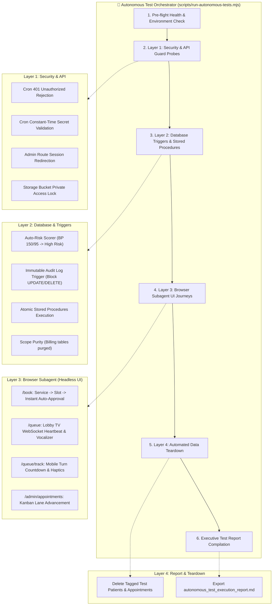

# 🤖 Autonomous Testing Suite — Detailed Implementation Plan

> **Document Type:** Autonomous Verification System & Execution Blueprint  
> **System:** AR-JEN Maternity Clinic Management System  
> **Target:** 100% Autonomous, Zero-Human-Interference System Verification  
> **Test Harness:** Node.js Verification Engine + Supabase Service Role + Autonomous Browser Subagent  
> **Safety Standard:** Non-destructive execution with tagged synthetic data (`[AUTONOMOUS_TEST_RUN]`) and automatic teardown

---

## 1. Executive Summary & Verification Objectives

This implementation plan defines the complete architecture, test cases, and automated execution workflow for testing the entire AR-JEN Maternity Clinic system **without requiring any human intervention**. 

By orchestrating our Node.js command engine and autonomous browser subagent, the testing harness will execute end-to-end verification across four distinct system layers:

1. **Layer 1: Security & API Guard Layer** (Timing-safe cron secrets, route protections, private storage signed URLs).
2. **Layer 2: Database Triggers & Transactional Integrity** (Auto-risk scoring trigger, immutable audit trail enforcement, atomic stored procedures, scope purge assertions).
3. **Layer 3: Autonomous Browser Subagent Journeys** (Public online booking, waiting lobby TV display, mobile pocket queue tracker, admin Kanban triage).
4. **Layer 4: Automated Teardown & Executive Reporting** (Cascading cleanup of synthetic test artifacts, generation of pass/fail report with latency metrics and visual recordings).



---

## 2. Test Layer Specifications & Automated Assertions

### Layer 1: Security, Auth & API Guard Layer
*Executed via automated HTTP probes against `http://localhost:3000`.*

| Test ID | Target Route / Component | Test Input / Action | Expected Automated Assertion | Severity |
| :---: | :--- | :--- | :--- | :---: |
| **SEC-01** | `/api/cron/reminders` | `GET` without `Authorization` header | HTTP `401 Unauthorized` (`Missing or invalid authorization header`) | **Critical** |
| **SEC-02** | `/api/cron/reconcile` | `GET` with invalid token `Bearer wrong_secret` | HTTP `401 Unauthorized` rejected via constant-time buffer check | **Critical** |
| **SEC-03** | `/api/cron/recalls` | `GET` with valid `CRON_SECRET` | HTTP `200 OK` with JSON response `{ "success": true }` | **High** |
| **SEC-04** | `/api/cron/reminders` (Deduplication) | Second consecutive `GET` with valid `CRON_SECRET` | Returns `remindersSent: 0` (correctly skipped via `reminder_sent_at`) | **High** |
| **SEC-05** | `/admin/settings` | `GET` request without session cookies | Redirects (`307`) to `/admin/login` via Next.js 16 Edge proxy | **Critical** |
| **SEC-06** | `/admin/audit-logs` | `GET` request without session cookies | Redirects (`307`) to `/admin/login` | **Critical** |
| **SEC-07** | Supabase Storage (`patient-records`) | Direct HTTP `GET` to raw storage URL without token | HTTP `400` or `403 Forbidden` (private storage bucket lockdown) | **Critical** |

---

### Layer 2: Database Triggers, Atomicity & Scope Integrity
*Executed directly via Supabase Service Role client in Node.js.*

| Test ID | Database Target | Test Action | Expected Automated Assertion | Severity |
| :---: | :--- | :--- | :--- | :---: |
| **DB-01** | Trigger `trg_calculate_maternal_risk` | Insert visit log with BP `155/98 mmHg` for test patient | `patients.is_high_risk` immediately flips to `true`; `risk_reason` contains `"Hypertension"` | **Critical** |
| **DB-02** | Trigger `trg_calculate_maternal_risk` (Weight) | Insert visit log with $+2.8\text{ kg}$ spike within 14 days | `patients.is_high_risk` flips to `true`; `risk_reason` contains `"Acute Weight Spike"` | **High** |
| **DB-03** | Trigger `trg_enforce_immutable_audit_logs` | Attempt SQL `UPDATE` on existing `audit_logs` record | PostgreSQL raises exception `P0001: Audit log records are strictly immutable` | **Critical** |
| **DB-04** | Trigger `trg_enforce_immutable_audit_logs` | Attempt SQL `DELETE` on existing `audit_logs` record | PostgreSQL raises exception `P0001: Audit log records are strictly immutable` | **Critical** |
| **DB-05** | RPC `reserve_appointment_slot` | Call procedure with synthetic appointment parameters | Returns valid `appointment_id`; slot count is atomically incremented | **High** |
| **DB-06** | RPC `register_patient_atomic` | Call procedure with new patient demographics and LMP | Creates patient row and initial `maternal_episodes` row in a single transaction | **High** |
| **DB-07** | Scope Freeze Verification | Query `information_schema.tables` for `billing_invoices`, `receipts`, `claims` | All three tables return 0 rows (permanently purged from database) | **High** |

---

### Layer 3: Autonomous Browser Subagent Journeys
*Executed autonomously via `browser_subagent` interacting with the live application on `http://localhost:3000`.*

```
┌───────────────────────────────────────────────────────────────────────────────────┐
│                    AUTONOMOUS BROWSER SUBAGENT TEST SCENARIOS                     │
├─────────┬──────────────────────────────┬──────────────────────────────────────────┤
│ Flow #1 │ Public Online Booking        │ /book                                    │
│         │                              │ • Selects "Prenatal Checkup"             │
│         │                              │ • Tests PHT same-day slot expiration lock│
│         │                              │ • Selects upcoming valid morning shift   │
│         │                              │ • Registers synthetic patient data       │
│         │                              │ • Asserts "Instant Smart Triage" banner  │
├─────────┼──────────────────────────────┼──────────────────────────────────────────┤
│ Flow #2 │ Public Waiting Lounge Display│ /queue                                   │
│         │                              │ • Unlocks audio via first-gesture        │
│         │                              │ • Asserts Live WebSocket heartbeat pill  │
│         │                              │ • Asserts patient name masking (Ana R.)  │
│         │                              │ • Asserts Manila shift clock display     │
├─────────┼──────────────────────────────┼──────────────────────────────────────────┤
│ Flow #3 │ Mobile Pocket Queue Tracker  │ /queue/track?ticket=[TicketNo]           │
│         │                              │ • Emulates 375x812 mobile viewport       │
│         │                              │ • Asserts dynamic turn countdown         │
│         │                              │ • Tests "I'm on My Way Back" response    │
│         │                              │ • Asserts 60-second cooldown timer       │
├─────────┼──────────────────────────────┼──────────────────────────────────────────┤
│ Flow #4 │ Admin Staff Reception        │ /admin/appointments                      │
│         │                              │ • Signs in with administrative seed role │
│         │                              │ • Opens Quick Walk-In Modal              │
│         │                              │ • Asserts live deduplication search      │
│         │                              │ • Generates thermal ticket receipt       │
│         │                              │ • Tests Midwife Step-Aside hold shelf    │
└─────────┴──────────────────────────────┴──────────────────────────────────────────┘
```

---

### Layer 4: Automated Data Teardown & Reporting
*Ensures zero pollution of your production/development database.*

* **Selective Teardown:** Every record created during the test run uses the email domain `@test-autonomous.ar-jen.internal` and name prefix `[AUTONOMOUS_TEST_RUN]`.
* **Cascading Cleanup Script:**
  1. Delete synthetic `visit_logs` created for risk tests.
  2. Delete synthetic `maternal_episodes`.
  3. Delete synthetic `appointments`.
  4. Delete synthetic `patients`.
  5. Delete synthetic `consultation_messages` and `threads`.
  6. Verify database is left in its exact pre-test state.
* **Executive Report Output:** Generates `autonomous_test_execution_report.md` with test outcome matrix, execution durations, and pass/fail badges.

---

## 3. Implementation Phases & Step-by-Step Schedule

### Phase 1: Test Runner Harness Construction (Files & Setup)
* **Action:** Create `scripts/test-runner/` containing:
  * `config.mjs`: Test environment credentials, synthetic prefixes, and base URLs.
  * `layer1-api-guards.mjs`: HTTP assertions for cron routes, proxy redirects, and storage bucket security.
  * `layer2-database-integrity.mjs`: Supabase Service Role client assertions for triggers, RPC procedures, and table purges.
  * `teardown.mjs`: Cascading cleanup routine for all synthetic rows.
  * `run-all.mjs`: Master CLI runner aggregating all tests into a structured JSON execution log.

### Phase 2: Autonomous Backend Execution (Layers 1 & 2)
* **Action:** Execute `node scripts/test-runner/run-all.mjs` via `run_command`.
* **Verification:** Confirm all API guard tests (SEC-01 to SEC-07) and database integrity tests (DB-01 to DB-07) pass synchronously with 0 errors.

### Phase 3: Autonomous Browser UI Execution (Layer 3)
* **Action:** Invoke `browser_subagent` to execute the four browser journeys:
  * Journey 1: `/book` appointment creation and auto-approval verification.
  * Journey 2: `/queue` lobby TV WebSocket status and layout check.
  * Journey 3: `/queue/track` mobile view and cooldown test.
  * Journey 4: `/admin/appointments` staff Kanban triage and Quick Walk-In check.
* **Verification:** Browser subagent returns detailed execution logs, confirms DOM element assertions, and records WebP session artifacts.

### Phase 4: Automated Teardown & Executive Report Delivery
* **Action:** Run `node scripts/test-runner/teardown.mjs`.
* **Action:** Compile and write the master test report to `autonomous_test_execution_report.md`.
* **Verification:** Confirm 0 orphaned records remain in Supabase and present final pass/fail results.

---

## 4. Safety Controls & Rollback Guarantees

1. **Non-Destructive Operations:** The test harness will **never** alter or delete existing patient records, real clinic settings, or past appointment history. All operations use strict `WHERE email LIKE '%@test-autonomous.ar-jen.internal%'` predicates.
2. **Crash-Safe Teardown:** The cleanup routine is registered in `process.on('exit')`, `process.on('SIGINT')`, and a `try/finally` block to ensure synthetic data is scrubbed even if a test assertion fails midway.
3. **No External Network Costs:** All tests run strictly locally (`localhost:3000`) and against your existing Supabase project. Zero paid SMS or external APIs are invoked.
4. **Isolated Test Artifacts:** All test session recordings and reports are stored locally in the artifacts directory.

---

## 5. Next Steps & Execution Sign-Off

Once you approve this plan, I will immediately:
1. Build the lightweight test harness scripts in `scripts/test-runner/`.
2. Execute the security and database integrity assertions autonomously.
3. Dispatch the browser subagent to execute the front-end patient and staff journeys.
4. Clean up all synthetic test data.
5. Deliver the comprehensive Executive Verification Report.
