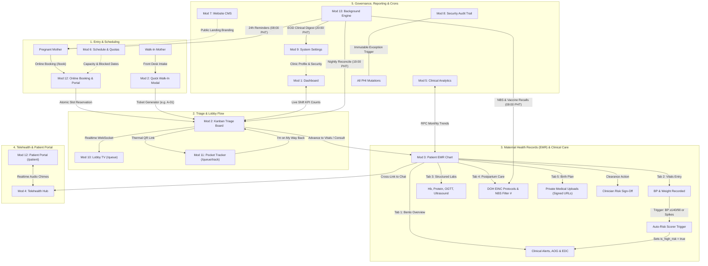

# 🏥 AR-JEN Maternity Clinic — Complete System Testing & Dataflow Guideline

> **Document Type:** Master Operational Testing Manual & Sequential Dataflow Guide  
> **System:** AR-JEN Maternity & Lying-In Clinic Digital Management System (Dasmariñas City, Cavite)  
> **Version:** Production Release Hardened (October 2026)  
> **Target Audience:** QA Testers, Clinical Attendants, Midwives, System Administrators, and Developers  
> **Scope Mandate:** 🔒 100% Maternal Clinical & Reception Focus (Zero billing, zero financial reimbursement claims)  
> **Budget Standard:** ₱0 Infrastructure (Free NodeMailer Gmail SMTP, Free Web Audio & Haptics, Free Vercel Cron)

---

## 📑 Table of Contents

1. [System Architecture & End-to-End Dataflow Topology](#1-system-architecture--end-to-end-dataflow-topology)
2. [Master Module & Feature Inventory (All 13 Modules)](#2-master-module--feature-inventory-all-13-modules)
   - [Module 1: Dashboard & Operational Overview](#module-1-dashboard--operational-overview)
   - [Module 2: Appointments & Live Reception Queue (Kanban)](#module-2-appointments--live-reception-queue-kanban)
   - [Module 3: Patient Directory & Electronic Maternal Health Records (EMR)](#module-3-patient-directory--electronic-maternal-health-records-emr)
   - [Module 4: Online Teleconsultations Hub](#module-4-online-teleconsultations-hub)
   - [Module 5: Clinical Analytics & Trends](#module-5-clinical-analytics--trends)
   - [Module 6: Clinic Schedule Management](#module-6-clinic-schedule-management)
   - [Module 7: Website Content CMS & Branding Studio](#module-7-website-content-cms--branding-studio)
   - [Module 8: Security Audit Trail](#module-8-security-audit-trail)
   - [Module 9: System Settings & Admin Credentials](#module-9-system-settings--admin-credentials)
   - [Module 10: Public Lobby TV Queue Display](#module-10-public-lobby-tv-queue-display)
   - [Module 11: Mobile Pocket Queue Tracker](#module-11-mobile-pocket-queue-tracker)
   - [Module 12: Online Booking & Patient Portal](#module-12-online-booking--patient-portal)
   - [Module 13: Background Automations & Mailer Engine](#module-13-background-automations--mailer-engine)
3. [Step-by-Step Sequential Manual Testing Guide (The "Golden Path")](#3-step-by-step-sequential-manual-testing-guide-the-golden-path)
   - [Phase A: System Baseline & Schedule Setup (Modules 6, 7, 9)](#phase-a-system-baseline--schedule-setup)
   - [Phase B: Online Booking & Smart Triage (Module 12)](#phase-b-online-booking--smart-triage)
   - [Phase C: Walk-In Intake & Queue Injection (Module 2)](#phase-c-walk-in-intake--queue-injection)
   - [Phase D: Triage Kanban & Stepped-Out Hold (Module 2)](#phase-d-triage-kanban--stepped-out-hold)
   - [Phase E: Lobby Calling & Pocket Queue Tracking (Modules 10, 11)](#phase-e-lobby-calling--pocket-queue-tracking)
   - [Phase F: Clinical Examination & Obstetric EMR Charting (Module 3)](#phase-f-clinical-examination--obstetric-emr-charting)
   - [Phase G: Clinician Risk Clearance Sign-Off (Module 3)](#phase-g-clinician-risk-clearance-sign-off)
   - [Phase H: Telehealth & Patient Communications (Modules 4, 12)](#phase-h-telehealth--patient-communications)
   - [Phase I: Executive Analytics & Clinical Dashboard Refresh (Modules 1, 5)](#phase-i-executive-analytics--clinical-dashboard-refresh)
   - [Phase J: Security Audit Trail Verification (Module 8)](#phase-j-security-audit-trail-verification)
   - [Phase K: Background Scheduled Cron Automations (Module 13)](#phase-k-background-scheduled-cron-automations)
4. [Test Persona Profiles & Realistic Clinical Datasets](#4-test-persona-profiles--realistic-clinical-datasets)
5. [Sanity Checks & Troubleshooting Matrix](#5-sanity-checks--troubleshooting-matrix)

---

## 1. System Architecture & End-to-End Dataflow Topology

The following diagram illustrates how patient records, clinical vitals, queue tickets, and notifications transition through the 13 modules of AR-JEN Maternity Clinic:



---

## 2. Master Module & Feature Inventory (All 13 Modules)

### Module 1: Dashboard & Operational Overview
- **Route:** `/admin`
- **Authorized Roles:** `admin`, `doctor`, `midwife`, `nurse`, `staff`
- **Core Features:**
  - **Live Shift KPI Banners:** High-performance $O(1)$ database head counts for Registered Patients, Lifetime Appointments, Today's Appointments, Ongoing Prenatal Episodes, and High-Risk Mothers.
  - **Live PHT Clock:** Active ticking banner anchored to Philippine Standard Time (`Asia/Manila`, UTC+8).
  - **High-Risk Maternal Watchlist:** Real-time alert list highlighting patients with elevated BP ($\ge 140/90\text{ mmHg}$), gestational diabetes, and rapid weight spikes, with reassuring emerald zero-state banner when baseline is stable.
  - **Triage Status Head Count Pills:** Exact counters for `Pending`, `Approved`, `Completed`, `No-Show`, and `Cancelled`.
  - **Quick Clinical Shortcuts:** 1-click jumps to New Patient Intake (`/admin/patients/new`), Appointments Kanban (`/admin/appointments`), and Lobby TV (`/queue`).

### Module 2: Appointments & Live Reception Queue (Kanban)
- **Route:** `/admin/appointments`
- **Authorized Roles:** `admin`, `doctor`, `midwife`, `nurse`, `staff`
- **Core Features:**
  - **4-Lane Drag-and-Drop Kanban Board:** Visual patient triage pipeline (`Waiting → Vitals → Consultation → Done`). Optimistic UI with real-time bidirectional synchronization between appointment status and triage lanes.
  - **Quick Walk-In Intake Dialog (`QuickWalkInModal`):** 30-second rapid reception modal with instant live deduplication (search-by-name), automatic patient account generation, queue ticket issuance, and thermal printer receipt slip generation with instant QR codes.
  - **Midwife Step-Aside Grace Shelf:** 1-click `[ Step Aside ]` action placing missing or stepped-out patients on temporary hold (`Stepped Out`) without stalling the clinic line.
  - **Grace Period Timer:** Live elapsed timer (*"On hold • ~12m"*) updating every 30 seconds with color transition (Amber $\rightarrow$ Rose) at $>25\text{ mins}$.
  - **Returning Patient Recovery:** 1-click `[ Return to Queue ]` moving stepped-out patients back to the front of the line with live cyan pulsing indicators.
  - **Historical Date Filters:** Quick PHT range filters (`Today`, `Yesterday`, `This Week`, `This Month`, `Custom Date Range`).
  - **Statutory RFC-4180 CSV Export:** 1-click spreadsheet download containing Ticket #, Patient Name, Age, Blood Type, Service, Time Shift, Walk-In status, High-Risk flag, and Allergies.

### Module 3: Patient Directory & Electronic Maternal Health Records (EMR)
- **Route:** `/admin/patients` and `/admin/patients/[id]`
- **Authorized Roles:** `admin`, `doctor`, `midwife`, `nurse`
- **Core Features:**
  - **Patient Directory Cohort View:** Searchable maternal registry with real-time search debouncing, AOG calculations, and DOH Maternal Census CSV export.
  - **3-Second Clinical Header:** Situational snapshot displaying Gravida/Para score, Blood Type, Age, Active Maternal Episode switcher, EDC due date countdown, and term status pills (*"Full Term 37-41w"* vs *"Preterm <37w"*).
  - **Tab 1 — Clinical Overview Bento:** Modular Bento cards displaying Naegele's AOG gestational progress bar, latest BP with Pre-eclampsia Triad alerts (BP $\ge 140/90$ + proteinuria), FHR bradycardia/tachycardia alerts, and PhilHealth MCP 4-visit compliance card.
  - **Tab 2 — Prenatal Visits Timeline:** Progressive checkup entry logging Gestational Age, Blood Pressure, Weight, Fundic Height, FHR, Presentation, and Attending Midwife notes.
  - **Tab 3 — Structured Labs & Ultrasound:** Dedicated tracking panels for Hemoglobin (CBC anemia detection), Urinalysis (Protein/Glucose/Pus Cells), Blood Typing, HBsAg, VDRL/RPR, and OGTT with *"⚡ Auto-fill Normal Defaults"* macro.
  - **Tab 4 — Postpartum & DOH Newborn Care (EINC):** Delivery outcome recording, APGAR scoring, baby birth weight (with grams-to-kg converter), and 1-click *"⚡ Apply DOH Protocols"* macro for Unang Yakap (immediate drying, skin-to-skin, delayed cord clamping, early breastfeeding, Vit K, eye prophylaxis, BCG, Hep B birth dose, and NBS filter card number).
  - **Tab 5 — Birth Plan & Private Documents:** Digital representation of the DOH paper birth plan and secure storage uploads using short-lived signed URLs (`createSignedUrl(path, 3600)`).
  - **DOH Emergency Transfer Slip (`EmergencyTransferModal`):** One-click printable standard Department of Health transfer form for emergency obstetric/neonatal hospital transfers with isolated `@media print` styling.
  - **Clinician High-Risk Clearance (`clearMaternalRiskFlag`):** Attending physician/midwife sign-off dialog documenting resolution notes (e.g., normalized BP across 3 visits) with immutable audit trail.

### Module 4: Online Teleconsultations Hub
- **Route:** `/admin/consultations`
- **Authorized Roles:** `admin`, `doctor`, `midwife`, `nurse`, `staff`
- **Core Features:**
  - **3-Column Telehealth Hub:** Left thread list, active conversation viewport, and collapsible Bedside Drawer clinical snapshot.
  - **Bedside Clinical Snapshot Drawer:** Viewing a patient inquiry automatically slides out their live AOG, latest BP, high-risk flags, allergies, and quick deep-links directly into EMR tabs (`?tab=obstetric`, `?tab=labs`).
  - **₱0 Web Audio Synthesizer Triage Chimes:** Dual-frequency synthesizer alerts for incoming patient messages with distinctive urgent harmonic danger alerts and mute/unmute toggle.
  - **DOH BEmONC Clinical Macros:** 1-click response templates for Pre-eclampsia Warning Signs, Active Labor Admission, and Fetal Kick Count protocols with Append/Replace modes.
  - **Touch Viewport Virtual Keyboard Guard:** Prevents accidental premature message dispatches on mobile phones and tablets by suppressing `Enter` on touch devices.

### Module 5: Clinical Analytics & Trends
- **Route:** `/admin/analytics`
- **Authorized Roles:** `admin`, `staff`
- **Core Features:**
  - **6-Month Clinical Volume Area Chart:** Historical consultation volume trends powered by database RPC `get_monthly_appointment_trends` with resilient fallback.
  - **Triage Service Distribution Pie Chart:** Real-time breakdown of clinical service types (Prenatal Checkup vs. Postpartum Care vs. General Consult vs. Safe Delivery).
  - **Operational Capacity Gauges:** Real-time calculation of completed consultations, patient attendance rates, and triage throughput speed.
  - **Scope Purity:** 100% focused on clinical patient volume; strictly zero financial revenue tracking.

### Module 6: Clinic Schedule Management
- **Route:** `/admin/schedule`
- **Authorized Roles:** `admin` (canManageSystemSettings)
- **Core Features:**
  - **PHT 7-Day Rolling Horizon Visualizer:** 7-day load visualizer anchored to Manila time (`Asia/Manila`, UTC+8) with color-coded load pills (`<70% Normal`, `70-90% Busy`, `>90% Peak`).
  - **Configurable Shift Quotas:** Adjust morning (AM) and afternoon (PM) max capacity with inline blur auto-save and animated `✓ Saved` feedback.
  - **Independent Weekend Policies:** Optimistic toggles for Saturday and Sunday operations (`🚫 Blocked / Closed` vs `✓ Open for Consults`).
  - **Holiday & Blackout Manager:** Add closure dates with 1-click Philippine presets (*"National Holiday"*, *"Midwife Staff Training"*, *"Facility Sanitation"*, *"Typhoon Advisory"*) and past-date selection locks (`min={today}`).
  - **Time Slot Overlap Pre-Validation:** Client-side prevention of inverted start/end times or conflicting appointment slots.

### Module 7: Website Content CMS & Branding Studio
- **Route:** `/admin/cms`
- **Authorized Roles:** `admin` (canManageSystemSettings)
- **Core Features:**
  - **Landing Page Hero & Copy Editor:** Edit public hero headline, subtitle, about us narrative, and Cavite facility address.
  - **Branding Studio (Logo & Favicon):** Upload clinic logos and favicons with client/server size ceilings (<3MB logo, <2MB favicon), MIME validation, and custom event broadcasting (`clinic-logo-updated`) updating the admin sidebar and browser `<link rel="icon">` without full-page reloads.
  - **Services Catalog Manager:** Add, edit, or toggle active services with character counter gauges and two-step safe deletion guards.
  - **SERP Snippet & Social Share Simulator:** Real-time desktop and mobile Google search card preview with title/description character limit warnings and OpenGraph social card simulator.
  - **Philippine Operating Hours Presets:** 1-click presets for Weekdays, Saturday, and Sunday (*"8AM-5PM"*, *"7AM-6PM"*, *"24/7 Delivery Only"*, *"Closed (Midwife On-Call)"*).

### Module 8: Security Audit Trail
- **Route:** `/admin/audit-logs`
- **Authorized Roles:** `admin` (Strictly restricted to Super Administrators)
- **Core Features:**
  - **Immutable Surveillance Ledger:** Backed by PostgreSQL `BEFORE UPDATE OR DELETE` exception triggers, rendering historical audit logs unalterable by any actor.
  - **Full Surveillance Coverage:** Records every creation, update, risk clearance, document access, and deletion of Protected Health Information (PHI).
  - **60fps Search with `useDeferredValue`:** High-speed filtering across actor email, action type, and patient IDs without UI input freeze.
  - **PHT Temporal Quick Filters:** 1-click filters for `All Time`, `Today's Shift`, `Past 7 Days`, and `Past 30 Days` in Manila time.
  - **Statutory RFC-4180 CSV Export with UTF-8 BOM:** 1-click download with official RA 10173 (Data Privacy Act of 2012) compliance preamble compatible with Microsoft Excel.
  - **Dual-Mode Metadata Inspector:** Inspect structured Bento metrics or syntax-highlighted raw JSON with 1-click clipboard copy.

### Module 9: System Settings & Admin Credentials
- **Route:** `/admin/settings`
- **Authorized Roles:** `admin` (canManageSystemSettings)
- **Core Features:**
  - **Clinic Profile Management:** Official clinic name, contact numbers, facility address, and emergency referral hotline notice.
  - **Philippine Contact Number Auto-Masking:** Automatic formatting for mobile (`09XX-XXX-XXXX`) and landline (`(046) XXX-XXXX`) with live regex validation.
  - **Administrator Authentication Sync:** Direct Supabase Auth credential mutations (`supabase.auth.updateUser`) synchronized with `public.users` and audited under RA 10173 statutory compliance.
  - **Real-Time Password Confirmation Gauge:** Client-side password strength meter with visual match validation (`✓ Matches` vs `✕ Mismatch`).
  - **Live System Diagnostics:** Real-time ticking Manila clock, Supabase database connection health, NodeMailer Gmail SMTP status, and statutory compliance badges (RA 10173, DOH AO 2016-0035, PhilHealth MCP, DOH BEmONC).

### Module 10: Public Lobby TV Queue Display
- **Route:** `/queue`
- **Authorized Roles:** Public / Waiting Room TV
- **Core Features:**
  - **Full-Screen 10-Foot UI:** High-contrast waiting lounge display featuring large typography, active ticket calling, and Manila shift clock.
  - **Decoupled Realtime WebSocket Heartbeat:** Live Supabase subscription with status indicator (🟢 Live WebSocket / 🟡 Reconnecting / 🔴 Offline Polling).
  - **Autonomous First-Gesture Audio Unlocker:** Floating sound prompt overcoming browser autoplay restrictions with global spacebar or touch gestures.
  - **Natural Filipino-English Voice Vocalizer:** Double-call cadence (*"Now calling ticket P 0 4, please proceed to Room 1"*) with phonetically spaced letters.
  - **Stepped-Out Recall Flasher:** High-visibility cyan pulsing cards for returning patients who stepped out of the clinic.
  - **Privacy-Compliant Name Masking:** Automatically masks patient names (`Maria S.`, `Ana R.`) in compliance with RA 10173.

### Module 11: Mobile Pocket Queue Tracker
- **Route:** `/queue/track` (URL param: `?ticket=A-01`)
- **Authorized Roles:** Public / Patient Smartphone
- **Core Features:**
  - **₱0 Mobile Web Tracker:** Accessible via thermal ticket QR code; requires zero app installations and zero paid SMS.
  - **Dynamic Turn Countdown:** Live position indicator (*"2 patients ahead • ~15 mins estimated wait"*).
  - **Haptic Vibration & Sound Alerts:** Hardware vibration (`navigator.vibrate`) and Web Audio chime when the patient's ticket is called.
  - **"I'm on My Way Back" Response Button:** Allows stepped-out mothers to alert front-desk midwives with a 60-second spam cooldown.

### Module 12: Online Booking & Patient Portal
- **Route:** `/book` and `/patient/*`
- **Authorized Roles:** Public / Registered Patient
- **Core Features:**
  - **Online Booking Engine (`/book`):** Step-by-step appointment scheduler with service selection, capacity-aware date picker, and same-day slot expiration guard (locks out concluded hours in PHT).
  - **Smart Triage Auto-Approval Engine:** Automatically grants instant confirmation for routine prenatal checkups if capacity is under 80% and the patient has zero no-shows.
  - **Atomic Capacity Reservation:** Prevents concurrent double-booking via `reserve_appointment_slot()` stored procedure.
  - **Patient Self-Service Portal (`/patient`):** View scheduled visits, access read-only obstetric history, review lab test summaries, and open two-way telehealth inquiries.
  - **Decoupled Dependent Switcher:** Supports mothers booking and managing records for newborn babies or family members under one account.

### Module 13: Background Automations & Mailer Engine
- **Routes:** `/api/cron/*`
- **Authorized Roles:** Vercel Cron with `CRON_SECRET` Bearer Token
- **Core Features:**
  - **Timing-Safe Authentication (`lib/cron-guard.js`):** Constant-time buffer comparison (`crypto.timingSafeEqual`) preventing timing attacks.
  - **24-Hour Appointment Reminders (`/api/cron/reminders`):** Dispatches email reminders at 08:00 PHT to patients scheduled for tomorrow; stamps `reminder_sent_at` to prevent duplicates.
  - **Expanded Newborn Screening & Vaccine Recalls (`/api/cron/recalls`):** Runs at 09:00 PHT to identify Day 3–5 postpartum deliveries for Newborn Screening (RA 9288) and 6-Week EPI vaccinations; stamps `nbs_recall_sent_at`.
  - **Nightly Care Recovery Reconcile (`/api/cron/reconcile`):** Runs at 19:00 PHT to transition unserved appointments to `No-Show` (`triage_status = 'missed'`), stamps `reconciled_at`, and dispatches empathetic reschedule recovery emails.
  - **Executive EOD Clinical Digest (`/api/cron/eod-report`):** Runs at 20:00 PHT to email the clinic administrator an operational summary (patient volume, service breakdowns, no-shows, high-risk surveillance, and chart preparation for tomorrow).

---

## 3. Step-by-Step Sequential Manual Testing Guide (The "Golden Path")

Follow these steps in exact chronological sequence to test the entire lifecycle of patient data as it flows through the clinic.

```
┌────────────────────────────────────────────────────────────────────────────────────────┐
│                          SEQUENTIAL MANUAL TESTING PHASES                              │
├────────┬─────────────────────────────────────┬─────────────────────────────────────────┤
│ Step A │ Clinic Setup & Capacity Quotas      │ Mod 6, 7, 9  (Admin Credentials)        │
│ Step B │ Online Booking & Smart Auto-Approve │ Mod 12       (Mother: Maria Santos)     │
│ Step C │ Walk-In Intake & Deduplication      │ Mod 2        (Mother: Ana Reyes)        │
│ Step D │ Triage Kanban & Stepped-Out Hold    │ Mod 2        (Reception Midwife)        │
│ Step E │ Lobby TV Calling & Pocket Tracker   │ Mod 10, 11   (Waiting Room & Mobile)    │
│ Step F │ Obstetric EMR Charting & Risk Scorer │ Mod 3        (Clinical Checkup Room)    │
│ Step G │ Clinician Risk Clearance Sign-Off   │ Mod 3        (Attending Doctor/Midwife) │
│ Step H │ Two-Way Telehealth Consultation     │ Mod 4, 12    (Patient Portal & Inbox)   │
│ Step I │ Clinical Dashboard & Analytics Refresh │ Mod 1, 5     (Admin Operations)         │
│ Step J │ Security Audit Trail Verification   │ Mod 8        (Compliance Officer)       │
│ Step K │ Automated Cron Background Jobs      │ Mod 13       (Scheduled Background)     │
└────────┴─────────────────────────────────────┴─────────────────────────────────────────┘
```

---

### Phase A: System Baseline & Schedule Setup
**Goal:** Verify clinic operating parameters, schedule capacities, and admin role security.

1. **Admin Login:**
   - Navigate to: `http://localhost:3000/admin/login`
   - Sign in using an administrative account (e.g., `admin@ar-jen.com` or your seed user).
   - **Verification:** System redirects smoothly to `/admin` dashboard; sidebar loads all 9 admin modules.

2. **Verify Schedule & Shift Quotas (Module 6):**
   - Navigate to: `/admin/schedule`
   - Observe the **7-Day Rolling Horizon Visualizer**. Verify that today's date matches Philippine Standard Time.
   - Click on the morning slot capacity input, change value to `12`, and click outside (blur).
   - **Verification:** An animated green checkmark pill (*"✓ Saved"*) appears briefly.
   - In **Blocked Dates Manager**, select a holiday date next month, choose preset chip *"National Holiday"*, and click `Block Date`.
   - **Verification:** Date card appears under Active Blocked Dates.

3. **Verify Clinic Profile & CMS (Modules 7 & 9):**
   - Navigate to: `/admin/settings` $\rightarrow$ Confirm phone number displays formatting mask (`09XX-XXX-XXXX`).
   - Navigate to: `/admin/cms` $\rightarrow$ Confirm hero headline and services catalog are rendered.

---

### Phase B: Online Booking & Smart Triage
**Goal:** Test public patient registration, same-day slot expiration guard, atomic slot reservation, and auto-approval.

1. **Open Incognito Browser Window:**
   - Navigate to public booking: `http://localhost:3000/book`
2. **Step 1: Service Selection:**
   - Select service: **"Prenatal Checkup"**. Click `Continue to Date & Time`.
3. **Step 2: PHT Date & Time Window:**
   - Select tomorrow's date (or an upcoming weekday).
   - Notice that if today's date is selected, hours that have already passed in PHT are disabled with a *"Past Session"* badge.
   - Choose time shift: **"Morning Shift (8:00 AM - 12:00 PM)"**. Click `Continue to Patient Information`.
4. **Step 3: Patient Intake:**
   - If not signed in, create account or register:
     - Name: `Maria Santos`
     - Email: `maria.santos.test@gmail.com`
     - Password: `Password123!`
     - Notes: `Routine 2nd trimester follow-up. Experiencing mild headaches.`
   - Click `Confirm Appointment Request`.
5. **Expected Results & Dataflow Verification:**
   - **Smart Triage Auto-Approval:** Because `Maria Santos` has 0 no-shows and requested routine prenatal care, the confirmation screen renders the green banner:
     `✓ Instant Smart Triage: Approved — Your slot is guaranteed.`
   - **Atomic Database Reservation:** Row created in `appointments` with `status = 'Approved'` and `triage_status = 'waiting'`.
   - **Confirmation Email:** Free NodeMailer Gmail engine logs email dispatch to `maria.santos.test@gmail.com`.

---

### Phase C: Walk-In Intake & Deduplication
**Goal:** Test front-desk reception flow, instant deduplication, and ticket issuance.

1. **Switch to Admin Browser Tab:**
   - Navigate to: `/admin/appointments`
   - Click the prominent rose button: `+ Quick Walk-In` (or press hotkey if modal is open).
2. **Test Deduplication Search:**
   - In the search field, type: `Maria Santos`.
   - **Verification:** Modal displays the existing patient record created in Phase B, preventing duplicate chart creation.
3. **Create New Walk-In Patient:**
   - Clear search and type: `Ana Reyes`.
   - Fill quick fields:
     - Age: `24`
     - Mobile: `0917-888-9999`
     - Service: `Routine Prenatal Checkup`
     - Initial BP: `145/95` (Elevated baseline)
     - Gestational Age / LMP: 6 months ago (approx 26 weeks)
   - Click `Generate Ticket & Inject to Queue`.
4. **Expected Results:**
   - Modal renders printable **Thermal Receipt Slip** (e.g. `Ticket # P-01` or `A-01`) complete with scannable QR code linking to `/queue/track?ticket=P-01`.
   - In background, patient record `Ana Reyes` is created in `patients`, active pregnancy episode provisioned, and appointment added directly into the Kanban **Waiting** lane.

---

### Phase D: Triage Kanban & Stepped-Out Hold
**Goal:** Test optimistic drag-and-drop triage, midwife grace shelf, and elapsed hold timers.

1. **Kanban Board Observation:**
   - In `/admin/appointments`, observe the **Waiting Room** lane.
   - You should see both `Maria Santos` (Ticket from online booking) and `Ana Reyes` (Ticket from walk-in).
2. **Drag-and-Drop Stage Advancement:**
   - Drag `Ana Reyes`'s card from **Waiting Room** $\rightarrow$ **Vitals Check**.
   - **Verification:** Card smoothly lands in **Vitals Check**. Database `triage_status` immediately updates to `'vitals'`.
3. **Test Midwife Step-Aside Grace Shelf:**
   - Suppose `Maria Santos` had to step outside the clinic to buy water.
   - On `Maria Santos`'s card, click the button: `[ Step Aside ]`.
   - **Verification:**
     - Card moves into the amber **"Stepped-Out / Grace Shelf"** container at the top of the board.
     - Live elapsed timer appears: *"On hold • ~0m"*.
     - Line is unblocked for other mothers.
4. **Test Return to Queue:**
   - Click `[ Return to Queue ]` on Maria's card.
   - **Verification:** Card moves back to the top of the **Waiting** lane with an active cyan `Returning` pulse pill.

---

### Phase E: Lobby Calling & Pocket Queue Tracking
**Goal:** Verify real-time lobby TV WebSockets, harmonic audio chimes, text-to-speech pronunciation, and pocket tracker response.

1. **Open Lobby TV in a Second Browser Window:**
   - Navigate to: `http://localhost:3000/queue`
   - Click anywhere on the screen to satisfy browser autoplay audio unlock policy.
   - **Verification:** Pulsing green heartbeat dot indicates `🟢 Live WebSocket Connected`.
2. **Open Pocket Queue Tracker on Mobile or Third Tab:**
   - Navigate to: `http://localhost:3000/queue/track?ticket=P-01`
   - **Verification:** Screen displays: *"Your Ticket: P-01 • 1 patient ahead • Estimated wait: ~12 mins"*.
3. **Call Patient from Admin Kanban:**
   - In `/admin/appointments`, advance `Ana Reyes` (Ticket `P-01`) to **Consultation Room**.
4. **Observe Real-Time Cross-Module Reactions:**
   - **On Lobby TV (`/queue`):**
     - Gentle synthesizer audio chime plays.
     - Natural voice vocalizes: *"Now calling Ticket P 0 1. Please proceed to Consultation Room."*
     - Large visual card flashes `Now Calling: Ticket P-01 — Ana R.`.
   - **On Pocket Tracker (`/queue/track`):**
     - Device triggers hardware vibration (`navigator.vibrate`) and plays Web Audio chime.
     - Card updates to: `IT'S YOUR TURN! Please enter Consultation Room 1`.
     - Tap button: `I'm on My Way Back`.
     - **Verification:** Button enters 60-second cooldown; admin card flashes green confirmation.

---

### Phase F: Clinical Examination & Obstetric EMR Charting
**Goal:** Test Naegele's AOG calculation, pre-eclampsia detection, automatic risk scoring trigger, and DOH protocol macros.

1. **Open Patient EMR Chart:**
   - From the Kanban card or by navigating to `/admin/patients`, open `Ana Reyes`'s chart: `/admin/patients/[id]`.
2. **Verify Tab 1 — Clinical Overview Bento:**
   - Situational Awareness check: Verify that AOG (Weeks + Days), Trimester badge, and EDC Naegele's date are clearly displayed within 3 seconds.
3. **Record Checkup Vitals (Tab 2 — Prenatal Visits):**
   - Click **Prenatal Visits** tab $\rightarrow$ Click `+ Record New Visit`.
   - Enter clinical parameters:
     - Visit Date: Today
     - Blood Pressure: `150/95` (Severe gestational hypertension)
     - Weight: `66.5` kg (representing a 2.5 kg spike from previous baseline)
     - Fundic Height: `26` cm
     - Fetal Heart Rate (FHR): `142` bpm (Normal baseline)
     - Presentation: `Cephalic`
   - Click `Save Visit Observation`.
4. **Verify PostgreSQL Auto-Risk Scorer Trigger:**
   - The database trigger `trg_calculate_maternal_risk` executes automatically on insert.
   - **Verification:**
     - Patient header immediately displays flashing red beacon: `⚠️ HIGH RISK PREGNANCY`.
     - Risk reason pill displays: `Hypertension (BP 150/95 mmHg) · Acute Weight Spike (+2.5 kg)`.
     - Bento BP widget activates Pre-eclampsia warning.
5. **Test Structured Lab Panel (Tab 3 — Labs & Screening):**
   - Click **Structured Labs** tab.
   - Click `+ Add Lab Result`.
   - Click the macro button: `⚡ Auto-fill Normal Defaults`.
   - Change `Urinalysis Protein` from `Negative` to `2+` (Matching pre-eclampsia triad).
   - Click `Save Lab Record`.
   - **Verification:** Bento overview updates to display: `Pre-eclampsia Triad (2+ Protein) — Urgent spot protein/creatinine & OB-GYN review`.
6. **Test DOH Emergency Obstetric Transfer Slip:**
   - In patient header, click: `Ambulance` icon button `Emergency Transfer Slip`.
   - **Verification:** Modal populates DOH referral form with maternal vitals (BP 150/95, AOG 26w, Risk: Pre-eclampsia).
   - Click `Print Transfer Slip` $\rightarrow$ Print preview renders isolated clinical referral form with signature blocks and zero URL header artifacts.
7. **Test DOH Newborn EINC Protocol (Tab 4 — Postpartum):**
   - Click **Postpartum & Newborn Care** tab.
   - Click `+ Record Delivery Outcome`.
   - Click macro button: `⚡ Apply DOH Protocols`.
   - **Verification:** All 4 Unang Yakap steps (immediate drying, skin-to-skin, delayed cord clamping, breastfeeding) and birth dose vaccines (Vit K, BCG, Hep B) are automatically checked.

---

### Phase G: Clinician Risk Clearance Sign-Off
**Goal:** Verify attending doctor/midwife risk resolution workflow and statutory notes recording.

1. **Trigger Risk Clearance:**
   - In `Ana Reyes`'s header, click the button: `Clear Risk Flag`.
2. **Fill Clearance Modal:**
   - Modal title: `Clear Maternal High-Risk Flag — Clinical Attending Safety Sign-off`.
   - In the justification box, type:
     `Blood pressure normalized to 115/75 mmHg after rest and observation. Patient asymptomatic for severe features. Cleared by Dr. Santos.`
   - Click `Confirm Clearance`.
3. **Verification:**
   - Page revalidates instantly.
   - Red High-Risk beacon unmounts.
   - Replaced by reassuring green badge:
     `✓ Risk Flag Cleared: Blood pressure normalized to 115...`
   - Hovering over badge displays full justification and clearance timestamp.

---

### Phase H: Telehealth & Patient Communications
**Goal:** Test two-way messaging between patient portal and staff telehealth hub with bedside clinical drawer.

1. **Patient Sends Inquiry from Portal (Window 1):**
   - Navigate to: `http://localhost:3000/patient/consultation`
   - Type message: `Good afternoon midwife, is it safe to take paracetamol for mild headache at 26 weeks?`
   - Click `Send Message`.
2. **Staff Receives Inquiry in Telehealth Hub (Window 2):**
   - In Admin portal, navigate to: `/admin/consultations`.
   - **Verification:**
     - Gentle Web Audio harmonic chime alerts staff.
     - New thread from `Ana Reyes` appears at top of inbox with unread counter.
3. **Inspect Bedside Clinical Drawer:**
   - Click on Ana's conversation thread.
   - The right column automatically hydrates the **Bedside Clinical Snapshot**:
     - Live AOG: `26 weeks`
     - Latest BP: `115/75 mmHg`
     - 1-Click deep links: `[ View EMR Labs ]`, `[ View Checkup Visits ]`.
4. **Dispatch Clinical Macro Reply:**
   - Click `Clinical Macros` dropdown.
   - Select: `Hydration & Left Lateral Rest`.
   - Click `Send Clinical Advice`.
   - **Verification:** Message delivers in real-time to patient's portal view with relative timestamp (*"Just now"*).

---

### Phase I: Executive Analytics & Clinical Dashboard Refresh
**Goal:** Verify real-time propagation of today's checkup and queue stats into operational dashboards.

1. **Inspect Clinical Analytics (Module 5):**
   - Navigate to: `/admin/analytics`.
   - **Verification:**
     - Completed Visits counter incremented.
     - Triage Service Distribution chart reflects Prenatal Consult and Walk-In proportions.
     - Monthly Trend Chart displays real database points without NaN or zero-state errors.
2. **Inspect Clinical Dashboard (Module 1):**
   - Navigate to: `/admin`.
   - **Verification:**
     - Active Prenatal Count reflects ongoing episode.
     - Today's shift appointments count is accurate.
     - High-Risk watchlist reflects updated clinical status.

---

### Phase J: Security Audit Trail Verification
**Goal:** Confirm immutable audit surveillance of all transactions executed in Phases A through H in compliance with RA 10173.

1. **Open Security Audit Trail (Module 8):**
   - Navigate to: `/admin/audit-logs`.
2. **Verify Audit Trail Entries:**
   - Filter by date: `Today's Shift`.
   - Search: `Ana Reyes`.
   - **Verification:** The following immutable events are present in chronological order:
     1. `CREATE_PATIENT` (Patient registration)
     2. `CREATE_MATERNAL_EPISODE` (AOG calculation)
     3. `CREATE_VISIT_LOG` (BP 150/95 recorded)
     4. `CLEAR_MATERNAL_RISK_FLAG` (Dr. Santos clearance with rationale)
     5. `SEND_CONSULTATION_MESSAGE` (Telehealth advice dispatched)
3. **Inspect Metadata Drawer:**
   - Click on the `CLEAR_MATERNAL_RISK_FLAG` row.
   - Inspector drawer opens:
     - Actor: Attending staff email
     - Entity ID: Patient UUID
     - Justification note matches exact text typed in Phase G.
4. **Test Statutory RFC-4180 CSV Export:**
   - Click `Export Audit Trail (CSV)`.
   - **Verification:** File downloads with `\uFEFF` UTF-8 BOM preamble and official RA 10173 statutory declaration.

---

### Phase K: Background Scheduled Cron Automations
**Goal:** Test scheduled cron jobs and verify delivery tracking deduplication.

You can trigger cron routes locally using `curl` or PowerShell with the `CRON_SECRET` Bearer token:

1. **Test 24h Advance Reminders (`/api/cron/reminders`):**
   ```bash
   curl -X GET "http://localhost:3000/api/cron/reminders" \
     -H "Authorization: Bearer <your_cron_secret>"
   ```
   - **Expected Response:** `{"success": true, "targetDate": "2026-10-16", "remindersSent": 1}`
   - **Deduplication Check:** Run the exact command a second time immediately.
   - **Verification:** `{"success": true, "remindersSent": 0}` (Correctly skipped because `reminder_sent_at` was stamped).

2. **Test Nightly Triage Reconcile (`/api/cron/reconcile`):**
   ```bash
   curl -X GET "http://localhost:3000/api/cron/reconcile" \
     -H "Authorization: Bearer <your_cron_secret>"
   ```
   - **Verification:** Any appointments left in `Waiting` or `Approved` on today's date transition to `No-Show` (`triage_status = 'missed'`), and `reconciled_at` is stamped.

3. **Test Postpartum NBS & Vaccine Recalls (`/api/cron/recalls`):**
   ```bash
   curl -X GET "http://localhost:3000/api/cron/recalls" \
     -H "Authorization: Bearer <your_cron_secret>"
   ```
   - **Verification:** Queries Day 3–5 deliveries lacking NBS cards and stamps `nbs_recall_sent_at`.

4. **Test Executive EOD Clinical Digest (`/api/cron/eod-report`):**
   ```bash
   curl -X GET "http://localhost:3000/api/cron/eod-report" \
     -H "Authorization: Bearer <your_cron_secret>"
   ```
   - **Verification:** Compiles comprehensive executive briefing (patient volume, service breakdown, high-risk cases, chart preparation roster) and dispatches HTML email to clinic administrator.

---

## 4. Test Persona Profiles & Realistic Clinical Datasets

Use these pre-constructed clinical personas to ensure consistent testing data across your QA team:

### Persona 1: "Maria Santos" (Routine Prenatal Booking)
- **Role:** Online Patient (Public Booking)
- **Age:** 28 | **Gravida/Para:** G2 P1 (1 Living child)
- **LMP:** 18 weeks ago | **Blood Type:** `O+`
- **Baseline Vitals:** BP 110/70 mmHg, Weight 58.0 kg, FHR 144 bpm
- **Intended Pathway:** Routine low-risk prenatal follow-up $\rightarrow$ Smart Triage Instant Auto-Approval $\rightarrow$ 24-hr Email Reminder.

### Persona 2: "Ana Reyes" (Acute High-Risk Walk-In)
- **Role:** Reception Walk-In Patient
- **Age:** 24 | **Gravida/Para:** G1 P0 (Primigravida)
- **LMP:** 26 weeks ago | **Blood Type:** `A+`
- **Baseline Vitals:** BP 150/95 mmHg (Elevated), Weight 66.5 kg (+2.5 kg spike), Proteinuria `2+`
- **Intended Pathway:** Front Desk Deduplication $\rightarrow$ Walk-In Ticket $\rightarrow$ Priority Vitals $\rightarrow$ Auto-Risk Scorer Flag $\rightarrow$ Pre-eclampsia Alert $\rightarrow$ DOH Emergency Transfer Form $\rightarrow$ Clinical Resolution Sign-Off.

### Persona 3: "Baby Boy Reyes" (Postpartum Delivery Outcome)
- **Role:** Newborn Dependent
- **Delivery Date:** 3 days ago (Eligible for ENBS Day 3-5)
- **Birth Weight:** 3,100 grams (3.10 kg) | **APGAR:** 9, 10
- **Intended Pathway:** Postpartum Tab $\rightarrow$ DOH EINC Protocol Macro $\rightarrow$ Newborn Screening Card # entry $\rightarrow$ 6-Week Vaccine Recall.

---

## 5. Sanity Checks & Troubleshooting Matrix

| Issue Observed During Testing | Root Cause | Immediate Verification & Fix |
| :--- | :--- | :--- |
| **Lobby TV audio chime does not sound when ticket is called** | Browser Autoplay Policy blocked unmuted audio because no user gesture occurred on the TV window. | Click anywhere on the `/queue` screen or press `Spacebar`. The floating sound banner will dismiss and Web Audio chimes will unlock. |
| **Pocket Tracker vibration does not activate on iPhone** | iOS Safari does not support the Web Vibration API (`navigator.vibrate`). | Expected iOS behavior. The tracker automatically falls back to high-contrast visual flash and Web Audio synthesizer chimes. |
| **Cron endpoint returns `401 Unauthorized`** | Missing or incorrect `CRON_SECRET` in request headers. | Provide `-H "Authorization: Bearer <CRON_SECRET>"` matching `.env.local`. |
| **"Access Restricted" banner appears when visiting `/admin/settings`** | Current user has clinical role `midwife` or `nurse` rather than `admin`. | Sign in with an account holding `role = 'admin'` in `public.users`. System settings and security audit logs are restricted to Super Administrators. |
| **Document upload fails with "File too large"** | Attachment exceeds the 10MB private storage ceiling. | Upload images or PDFs under 10MB. Verify file formats are within `.pdf, .jpg, .png, .webp, .doc`. |
| **Appointment time slot shows "Past Session" on today's date** | The selected appointment shift has already begun or passed in Philippine Standard Time (PHT). | Choose a future date or an upcoming shift. The online booking system automatically prevents back-dated appointments. |

---

> **End of Guideline.**  
> *AR-JEN Maternity Clinic Management System — Engineered for Patient Safety, Clinical Rigor, and Zero-Cost Scalability.*
