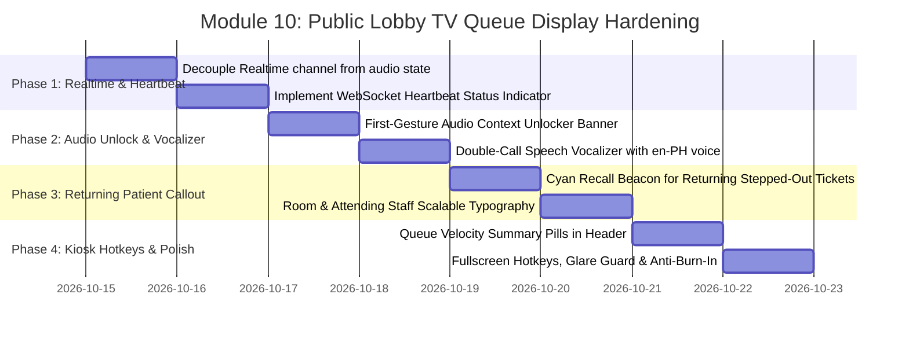

# 📺 Implementation Plan: Module 10 — Public Lobby TV Queue Display

> **Focus:** Hardening the Real-Time Public Waiting Lobby Queue Display, Browser Autoplay Audio Policy Resolution, Resilient WebSocket Heartbeats, Voice Ticket Vocalization, and Stepped-Out Patient Recalls for AR-JEN Maternity Clinic.  
> **Status:** Plan Ready for Review & Implementation  
> **Architecture Constraint:** Strict Scope Freeze (0 new routes, 0 new tables). ₱0 cost (Free Web Audio Synthesizer, Free Browser Speech Synthesis, Free Supabase WebSockets). Dark High-Contrast Glare-Resistant Design for 1080p/4K TV Kiosks.

---

## 1. Executive Summary & Operational Mandate

In a high-volume community lying-in clinic such as **AR-JEN Maternity Clinic** (Dasmariñas City, Cavite), the **Public Lobby TV Queue Display** (`/queue`) is the primary visual and acoustic guide for pregnant mothers, family members, and accompanying companions waiting in the reception lounge:

1. **Acoustic Clarity & Triage Calling:** Mothers in early labor, pregnant women experiencing fatigue, or parents holding infants cannot be expected to constantly stare at a screen. Auditory cues (dual-frequency harmonic chimes and synthesized natural voice announcements) are essential to prevent missed appointments and reduce hallway congestion.
2. **Autonomous Kiosk Reliability (24/7 Operations):** Lobby TVs are mounted on clinic walls, powered by mini-PCs, smart TV browsers, or kiosk tablets. The display must operate unattended for entire 12-to-24 hour shifts without crashing, leaking memory, burning in OLED/LED screens, or falling out of sync when local clinic Wi-Fi drops.
3. **Current Friction Points & Technical Gaps:**
   - **Browser Autoplay Audio Policy Muting:** Browsers block unmuted audio contexts until an explicit user gesture. When staff boot the TV in the morning, audio defaults to muted (`audioEnabled: false`), and ticket calls make zero sound unless a tiny icon is clicked.
   - **WebSocket Tear-Down Anti-Pattern:** The Supabase Realtime subscription `useEffect` currently depends on `[audioEnabled]`, meaning toggling audio unnecessarily destroys and reconnects the WebSocket channel.
   - **Silent Realtime Disconnections:** If clinic Wi-Fi drops, the lobby TV offers no indication whether the displayed numbers are live or stale.
   - **Single-Utterance Speech Synth:** Calling a ticket only once in noisy clinic environments leads to missed numbers. Voice synth lacks repetition and local pronunciation cadence.
   - **Stepped-Out Recall Ambiguity:** When stepped-out patients return from outside ("On Way Back"), calling them into consultation looks identical to a standard call, causing confusion at the front desk.

This plan details the systematic hardening of **Module 10** into an unattended, resilient, and human-friendly lobby display system.

---

## 2. Master Nuance & Friction Point Matrix

| # | Friction Point / Identified Gap | Clinical & Operational Impact | Technical Solution | Target Files |
| :--- | :--- | :--- | :--- | :--- |
| **1** | **Browser Autoplay Audio Policy Lock** (`app/queue/page.jsx:88-150`) | Browsers suspend `AudioContext` without a user interaction. The TV starts silently, and clinic staff often miss that the audio is disabled. | Implement an automated First-Gesture Audio Unlocker: listen to global `click`, `keydown`, or `touchstart` anywhere on the screen to initialize `AudioContext`, accompanied by a glowing top banner prompt (*"Click anywhere to enable voice calling"*). | `app/queue/page.jsx` |
| **2** | **WebSocket Subscription Thrashing** (`app/queue/page.jsx:164-180`) | `useEffect` for the Supabase Realtime channel has `[audioEnabled]` in its dependency array. Toggling mute tears down and recreates the WebSocket connection. | Decouple Realtime channel from audio state. Mount the channel once on page load and use an `audioEnabledRef` to read current audio preferences without re-subscribing. | `app/queue/page.jsx` |
| **3** | **Absence of Realtime Connection Heartbeat** (`app/queue/page.jsx:164-180`) | If clinic Wi-Fi drops, the screen could show frozen numbers without staff noticing that Realtime updates have stopped. | Track Supabase channel subscription statuses (`SUBSCRIBED`, `CLOSED`, `CHANNEL_ERROR`) and browser `online`/`offline` events. Render a live pulse status indicator (🟢 Live WebSocket / 🟡 Reconnecting / 🔴 Offline Polling). | `app/queue/page.jsx` |
| **4** | **Single-Pass Voice Synth in Noisy Lobby** (`app/queue/page.jsx:66-80`) | Speech synthesis says the ticket number only once. In a bustling waiting area, patients frequently miss the announcement. | Upgrade voice announcements with double-call cadence: *"Now calling: Ticket P 04. Ticket P 04, please proceed to Consultation Room."* Prefer `en-PH` voice if available in browser voice list. | `app/queue/page.jsx` |
| **5** | **Stepped-Out "Returning" Patient Recall Callout** (`app/queue/page.jsx:256-290`) | Stepped-out patients who tap *"I'm on My Way Back"* on `/queue/track` are called into consultation without visual differentiation from regular queue numbers. | Detect returning patients (`triage_status === 'returning'`) and render a high-contrast Cyan/Amber recall beacon with an explicit vocal advisory: *"Returning patient, ticket [X], please proceed to Consultation Room."* | `app/queue/page.jsx` |
| **6** | **Missing Queue Velocity & Capacity Bar** (`app/queue/page.jsx:205-250`) | Waiting mothers and families cannot gauge how quickly the queue is moving or how many patients are ahead. | Add an ergonomic lobby queue velocity pill bar in the header: total patients today, active consults, vitals in progress, and waiting count. | `app/queue/page.jsx` |
| **7** | **TV Anti-Burn-In & Kiosk Keyboard Shortcuts** (`app/queue/page.jsx:182-189`) | Running 24/7 on static LED/OLED displays risks burn-in. Staff operating with wireless presentation clickers or TV remotes lack hotkeys. | Add gentle 60-second micro-shifts and subtle gradient animations to prevent pixel burn-in. Implement kiosk keyboard shortcuts (`F` for Fullscreen, `M` or `Space` for Mute/Unmute, `R` to force reload). | `app/queue/page.jsx` |

---

## 3. System Architecture & Audio-Visual State Machine

```mermaid
graph TD
    subgraph Clinic Operations (Midwives & Staff)
        A1[Triage Midwife Moves Card to Consultation in Kanban] --> SB[(Supabase: appointments table)]
        A2[Stepped-Out Patient Taps 'On My Way Back' in Pocket Tracker] --> SB
    end

    subgraph Realtime Subscription Layer (app/queue/page.jsx)
        SB -- "postgres_changes (appointments)" --> CH[Supabase Realtime Channel: public-lobby-queue-stream]
        CH -- "Channel Status: SUBSCRIBED" --> HB[Heartbeat: 🟢 Live WebSocket]
        CH -- "Channel Status: CLOSED/ERROR" --> HB_ERR[Heartbeat: 🟡 Auto-Reconnecting]
        CH --> FQ[fetchQueue /api/queue]
        POLL[20s Fallback Interval] --> FQ
    end

    subgraph Audio Engine (Web Audio & Speech Synth)
        FQ --> DETECT{Newly Called Ticket?}
        DETECT -- Yes --> AUD_CHECK{audioEnabled?}
        AUD_CHECK -- Yes --> CHIME[playClinicChime: Dual-Tone Melodic Chime D5/A5]
        CHIME --> SPEECH[speakTicketCall: Natural Voice with Double Ticket Repetition]
        AUD_CHECK -- No --> PROMPT[Flash Glowing Audio Banner: Click anywhere to unlock]
    end

    subgraph Lobby Display Rendering (1080p / 4K Kiosk)
        DETECT -- Yes --> FLASH[callingFlash: 8s High-Contrast Glow Ring]
        FQ --> REN_LEFT[Left Col: NOW CALLING - Big Monospace Ticket & Room Destination]
        FQ --> REN_RIGHT1[Right Col: AT TRIAGE - Vital Signs Room]
        FQ --> REN_RIGHT2[Right Col: WAITING LIST - Next In Line with Priority Tint]
        FQ --> REN_RIGHT3[Right Col: MISSED / STEPPED OUT - Cyan 'On Way Back' Beacon]
        FQ --> REN_HEAD[Header: PHT Live Clock, Velocity Pills, Connection Dot]
    end
```

---

## 4. Step-by-Step Implementation Roadmap



---

### Phase 1: Realtime Subscription Decoupling & Connection Heartbeat

#### 1.1. Decouple Channel from `audioEnabled` State
- Currently, when `audioEnabled` toggles, the `useEffect` cleans up and recreates the channel.
- Fix: Use `useRef` for `audioEnabled`:
  ```javascript
  const audioEnabledRef = useRef(audioEnabled);
  useEffect(() => {
    audioEnabledRef.current = audioEnabled;
  }, [audioEnabled]);
  ```
- Initialize the Supabase Realtime channel once with `[]` dependency array.

#### 1.2. WebSocket Heartbeat Status Indicator
- Track connection state:
  ```javascript
  const [connectionStatus, setConnectionStatus] = useState('connecting'); // 'connected' | 'connecting' | 'reconnecting'
  ```
- Listen to channel events:
  ```javascript
  channel.subscribe((status) => {
    if (status === 'SUBSCRIBED') setConnectionStatus('connected');
    else if (status === 'CLOSED' || status === 'CHANNEL_ERROR') setConnectionStatus('reconnecting');
  });
  ```
- Listen to browser `window.addEventListener('offline')` and `'online'`.
- Display a discreet, pulsing badge in the header:
  - 🟢 `Live Stream Active`
  - 🟡 `Reconnecting Realtime...`
  - 🔴 `Offline (Using Polling Backup)`

---

### Phase 2: Autonomous First-Gesture Audio Unlocker & Voice Vocalizer

#### 2.1. First-Gesture Audio Unlocker & Floating Banner
- Browsers require an initial user interaction to play unmuted audio.
- Add an interactive global listener on `window`:
  ```javascript
  useEffect(() => {
    if (audioEnabled) return;
    const unlockAudio = () => {
      setAudioEnabled(true);
      playClinicChime();
      window.removeEventListener('click', unlockAudio);
      window.removeEventListener('keydown', unlockAudio);
      window.removeEventListener('touchstart', unlockAudio);
    };
    window.addEventListener('click', unlockAudio);
    window.addEventListener('keydown', unlockAudio);
    window.addEventListener('touchstart', unlockAudio);
    return () => {
      window.removeEventListener('click', unlockAudio);
      window.removeEventListener('keydown', unlockAudio);
      window.removeEventListener('touchstart', unlockAudio);
    };
  }, [audioEnabled]);
  ```
- When `audioEnabled === false`, display a floating Magic UI prompt banner:
  *"🔊 Audio Calling Muted by Browser — Click anywhere or press Spacebar to enable clinic chimes & voice calling"* with an animated speaker pulse.

#### 2.2. Double-Call Natural Voice Vocalizer
- Upgrade `speakTicketCall` in [app/queue/page.jsx](file:///c:/Users/admin/Desktop/arjen-clinic/app/queue/page.jsx):
  - Formats ticket letters cleanly: `"P-04"` $\rightarrow$ `"P 0 4"`.
  - Repeats ticket number twice for acoustic clarity in large lobbies:
    *"Now calling: Ticket P 0 4. Ticket P 0 4, please proceed to the Consultation Room."*
  - If a returning patient is called:
    *"Returning patient, Ticket P 0 4. Please proceed to the Consultation Room."*
  - Automatically selects natural voice if available:
    ```javascript
    const voices = window.speechSynthesis.getVoices();
    const phVoice = voices.find(v => v.lang.includes('en-PH')) || voices.find(v => v.lang.includes('en-US')) || voices[0];
    if (phVoice) utterance.voice = phVoice;
    ```

---

### Phase 3: Stepped-Out "Returning" Patient Recall Callout

#### 3.1. Visual Recall Beacon for Returning Patients
- When a patient on the grace shelf has `triage_status === 'returning'` and gets called into `Consultation`:
  - Render an unmistakable Cyan/Amber glowing border ring and badge:
    `RECALL: RETURNING PATIENT`
  - Keep the ticket highlighted so lobby midwives know the patient was previously stepped out.

#### 3.2. Stepped-Out Grace Shelf Presentation
- Keep the `Missed Numbers / Stepped Out` shelf prominent at the bottom of the right column:
  - Cyan badge for `On Way Back` tickets with a live pulsing beacon.
  - Clear instruction: *"If your number was called while you were outside, please approach the Front Desk to resume."*

---

### Phase 4: Big-Screen Ergonomics, Velocity Pills & Kiosk Controls

#### 4.1. Header Queue Velocity Summary Pills
- Add high-level counters above the clock:
  - Total in Queue: `queue.length`
  - Now Serving: `nowCalling.length`
  - In Triage: `inTriage.length`
  - Waiting: `waitingList.length`
- Gives mothers situational awareness regarding lobby turnaround time.

#### 4.2. Kiosk Hotkeys & Screen Burn-In Protection
- Keyboard shortcuts for clinic staff managing the TV kiosk:
  - `F` or `F11`: Toggle Fullscreen mode
  - `M` or `Space`: Toggle Audio mute/unmute
  - `R`: Immediate manual queue refresh
- Gentle radial gradient drift (`animate-pulse duration-10000`) across background ambient lights to prevent LED pixel burn-in over 24/7 continuous operation.

---

## 5. Verification & Acceptance Criteria

1. **Autoplay Audio Unlock:** Opening `/queue` shows the audio enable banner; clicking anywhere on the screen immediately enables audio and plays a confirmation chime.
2. **WebSocket Resiliency:** Toggling mute does NOT disconnect the Supabase channel. Cutting network connectivity triggers the yellow "Reconnecting" status badge, and restoring network immediately turns it green without a page refresh.
3. **Speech Vocalization:** Ticket calls announce the ticket number twice with correct letter spacing (`P 0 4`), and returning patients are vocalized as returning calls.
4. **Returning Beacon:** When a stepped-out ticket with `returning` status is called, it renders with cyan highlight and "Recall" badges.
5. **No Layout Overflow:** The screen scales gracefully on standard 1080p and 4K displays with zero scrollbars in fullscreen mode.
6. **Code Quality:** Zero ESLint errors or warnings, clean React 19 execution, zero hydration mismatches.
7. **Scope & Budget Constraint:** 0 new tables, 0 paid APIs, ₱0 cost.
