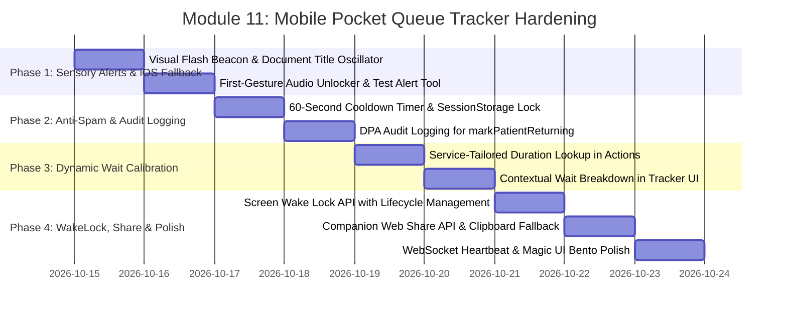

# 📱 Implementation Plan: Module 11 — Mobile Pocket Queue Tracker

> **Focus:** Hardening the Zero-Cost Mobile Pocket Queue Tracker (`/queue/track?ticket=...`), Cross-Platform iOS Safari Sensory Alerts (Vibration Fallback & Audio Context Unlock), 60-Second "On My Way Back" Cooldown Guard, Service-Tailored Dynamic Wait Calibration, Screen WakeLock API, Companion Web Share, and Resilient WebSocket Heartbeats for AR-JEN Maternity Clinic.  
> **Status:** Plan Ready for Review & Implementation  
> **Architecture Constraint:** Strict Scope Freeze (0 new routes, 0 new database tables). ₱0 cost (Free Web Audio API, Free Screen Wake Lock API, Free Web Vibration API with iOS visual fallbacks, Free Supabase WebSockets, Free Web Share API). Mobile-First Magic UI / 21st.dev Glassmorphism Bento Design.

---

## 1. Executive Summary & Mobile Patient Experience Mandate

In a high-volume community lying-in clinic such as **AR-JEN Maternity Clinic** (Dasmariñas City, Cavite), the **Mobile Pocket Queue Tracker** (`/queue/track`) is an indispensable digital companion for expectant mothers, mothers with newborns, and accompanying family members:

1. **Patient Comfort & Decongestion:** Waiting rooms in community maternity clinics can quickly become crowded, warm, and noisy. Expectant mothers in their third trimester or mothers cradling fragile neonates should not be forced to sit shoulder-to-shoulder inside the lobby for 45+ minutes. The pocket tracker empowers them to step outside to wait in shaded outdoor gazebos, visit nearby pharmacies, eat at local carinderias, or rest inside private vehicles while retaining continuous, real-time awareness of their queue standing.
2. **₱0 Budget & Zero-App-Install Accessibility:** Patients scan a dynamic QR code printed on their thermal ticket slip (from `QuickWalkInModal`) or enter their ticket code (`W-001`, `P-004`). There are no native apps to download from app stores, no account registrations, and no paid SMS charges (Semaphore, Twilio). Everything operates natively in standard mobile web browsers (Safari, Chrome, Edge).
3. **Current Friction Points & Technical Gaps in Module 11:**
   - **iOS Safari Vibration Non-Support:** Apple's WebKit explicitly does not support `navigator.vibrate` (`undefined` on iOS). When an iPhone user's ticket is called to Vital Signs or Consultation, they receive zero haptic sensation.
   - **Browser Autoplay Audio Policy Silence:** Web Audio contexts require an explicit user gesture. Because ticket URLs are often opened directly via QR code scans, audio defaults to muted, leaving patients unaware when their turn arrives.
   - **"I'm on My Way Back" Rapid Spamming:** When stepped-out patients tap *"I'm on My Way Back!"*, the current button lacks a cooldown lock. An anxious or bumpy-tricycle patient can rapidly tap the button repeatedly, triggering redundant database writes. Furthermore, `markPatientReturning` lacks DPA audit logging.
   - **Flat 12-Minute Wait Constant:** The current wait estimation formula multiplies `patientsAhead * 12` uniformly across all clinical visits. In lying-in reality, a General Consult takes ~8 minutes, a Prenatal Checkup takes ~12 minutes, and a Safe Delivery / Labor Intake takes ~25 minutes. A flat constant leads patients to misjudge their return time.
   - **Screen Sleeping & Background Throttling:** Mobile devices sleep after 30 to 60 seconds of inactivity, throttling background WebSockets and timers. Without Screen Wake Lock handling, tickets called while the phone is asleep can be missed.
   - **Silent Connectivity Losses:** If cellular reception fluctuates outside the clinic, patients receive no indication whether their queue number is actively updating or stale.

This plan details the systematic hardening of **Module 11** into a resilient, sensory-rich, and clinically calibrated pocket tracker.

---

## 2. Master Nuance & Friction Point Matrix

| # | Friction Point / Identified Gap | Clinical & Operational Impact | Technical Solution | Target Files |
| :--- | :--- | :--- | :--- | :--- |
| **1** | **iOS Safari Vibration Non-Support** (`app/queue/track/page.jsx:54-62`) | `navigator.vibrate` is unsupported on iOS. Expectant mothers using iPhones receive zero haptic notification when their turn is called, risking missed appointments. | Implement high-contrast visual flash fallback (rapid oscillating Rose/Cyan glowing ring & border beacon) + alternating document title alert (`🔔 YOUR TURN! Ticket [X]`) + Web Audio chime as guaranteed cross-platform alerts. | `app/queue/track/page.jsx` |
| **2** | **Mobile Autoplay Audio Policy Lock** (`app/queue/track/page.jsx:26-52, 74`) | Browsers suspend `AudioContext` without prior user interaction. Defaulting `audioEnabled` to false leaves tracker silent unless user spots the tiny volume toggle. | Implement an automated First-Gesture Audio Unlocker banner (*"🔔 Tap anywhere to enable sound alerts"*), unlock audio on search submission, and provide a *"⚡ Test Sound & Alert"* button so mothers can verify chime and haptics before stepping away. | `app/queue/track/page.jsx` |
| **3** | **"On My Way Back" Rapid Spamming & Unlogged Mutation** (`app/queue/track/page.jsx:176-205`, `app/actions.js:565-596`) | Repeated taps trigger multiple database writes. `markPatientReturning` lacks DPA audit logging and cooldown feedback. | Implement a 60-second client-side cooldown lock with an animated ticking countdown button (`[✓ Midwife Notified • Approach Desk (54s)]`), persisted in `sessionStorage`. Instrument `markPatientReturning` with an immutable DPA audit log (`UPDATE_TRIAGE_STATUS`). | `app/queue/track/page.jsx`, `app/actions.js` |
| **4** | **Uniform 12-Minute Wait Assumption** (`app/actions.js:650`) | Uniform `patientsAhead * 12` calculates 36m for 3 quick consults (actual ~24m) or 12m for a labor intake (actual ~25m), causing patients to either miss their turn or wait anxiously in the lobby. | Calibrate wait estimation by calculating the sum of clinical service durations of actual patients ahead: Labor Intake (~25m), Prenatal (~12m), Postpartum/NBS (~10m), General Consult (~8m). Return calibrated minutes with contextual breakdown. | `app/actions.js`, `app/queue/track/page.jsx` |
| **5** | **Mobile Screen Sleep Throttling (Screen Wake Lock)** (`app/queue/track/page.jsx:64-166`) | Mobile screens lock after 30-60s of inactivity, throttling timers and suspending audio playback. | Implement the **Screen Wake Lock API** (`navigator.wakeLock.request('screen')`) during active waiting sessions with automatic re-acquisition on `visibilitychange`. Render a subtle Magic UI toggle pill: `[ 🔆 Screen Awake ]`. | `app/queue/track/page.jsx` |
| **6** | **Background Tab Alert Flashing** (`app/queue/track/page.jsx:108-122`) | Patients often switch to messaging or social media apps while waiting in line. | When ticket transitions to `Vital Signs` or `Consultation`, oscillate `document.title` between `"🔔 YOUR TURN! Ticket [X]"` and `"AR-JEN Clinic Tracker"` every 1000ms until focused or acknowledged. | `app/queue/track/page.jsx` |
| **7** | **Companion Tracker Sharing (Web Share API)** (`app/queue/track/page.jsx:218-267`) | Expectant fathers, companions, or family drivers cannot easily monitor the queue from their own phones without manually typing the URL. | Add a 1-click **"Share Tracker"** action using the native `navigator.share` API (with 1-click clipboard fallback and micro-animated `✓ Link Copied!` badge) so companions can track in real-time. | `app/queue/track/page.jsx` |
| **8** | **WebSocket Connection Heartbeat & Offline Status** (`app/queue/track/page.jsx:142-166`) | Outside the clinic, cellular data may momentarily disconnect without the user noticing frozen numbers. | Monitor Supabase Realtime channel state (`SUBSCRIBED`, `CLOSED`, `CHANNEL_ERROR`) and browser `navigator.onLine`. Render a live pulse status indicator (🟢 Live Sync / 🟡 Polling / 🔴 Offline) with relative last-update timestamps. | `app/queue/track/page.jsx` |

---

## 3. System Architecture & Mobile State Machine Diagram

```mermaid
graph TD
    subgraph Clinic Operations (Midwives & Clinicians)
        K1[Midwife moves ticket to Vital Signs in Kanban] --> SB[(Supabase: appointments table)]
        K2[Clinician moves ticket to Consultation in Kanban] --> SB
        K3[Midwife moves missing patient to Stepped Out] --> SB
    end

    subgraph Realtime Subscription Layer (/queue/track)
        SB -- "postgres_changes (appointments)" --> RT[Supabase Realtime Channel: pocket-queue-TICKET]
        RT -- "Status: SUBSCRIBED" --> HB_LIVE[Heartbeat: 🟢 Live Sync]
        RT -- "Status: TIMED_OUT / CLOSED" --> HB_POLL[Heartbeat: 🟡 Auto-Polling 12s]
        NAV_OFF[navigator.onLine = false] --> HB_OFF[Heartbeat: 🔴 Offline]
        RT --> FETCH[loadTicket / fetchTicketStatus]
    end

    subgraph Sensory Alert Engine (Cross-Platform / iOS Fallback)
        FETCH --> STATUS_CHECK{Status Changed to Triage or Consult?}
        STATUS_CHECK -- Yes --> VIB_CHECK{navigator.vibrate supported?}
        VIB_CHECK -- Yes (Android) --> VIB[triggerHapticFeedback: 300-150-300-150-500ms]
        VIB_CHECK -- No (iOS Safari) --> FLASH[Visual Flash Beacon: Rapid Pulsing Rose/Cyan Ring]
        STATUS_CHECK -- Yes --> TITLE_FLASH[Oscillate document.title: 🔔 YOUR TURN!]
        STATUS_CHECK -- Yes --> AUD_CHECK{audioEnabled?}
        AUD_CHECK -- Yes --> CHIME[playAlertChime: Dual Harmonic D5/A5 Web Audio]
        AUD_CHECK -- No --> UNLOCK_PROMPT[Render Glowing Sound Unlock Prompt]
    end

    subgraph Stepped Out Recovery Flow
        STATUS_CHECK -- "Status == Stepped Out" --> GRACE_CARD[Grace Shelf Hold Card]
        GRACE_CARD --> TAP_RETURN[Patient taps 'I'm on My Way Back!']
        TAP_RETURN --> COOLDOWN_CHECK{In 60s Cooldown?}
        COOLDOWN_CHECK -- Yes --> PREVENT[Prevent Tap & Show Remaining Seconds]
        COOLDOWN_CHECK -- No --> DISPATCH[markPatientReturning Action]
        DISPATCH --> AUDIT[(DPA Audit Log: UPDATE_TRIAGE_STATUS)]
        DISPATCH --> SET_COOL[Set sessionStorage Cooldown: 60s]
        DISPATCH --> REASSURE[Display Midwife Notified Confirmation Banner]
    end

    subgraph Screen WakeLock & Companion Share
        TRACK_ACTIVE{Ticket Active?} -- Yes --> WAKE[Request navigator.wakeLock screen]
        VIS_CHANGE[document.visibilitychange] --> RE_WAKE[Re-acquire WakeLock if visible]
        SHARE_BTN[Tap Share Tracker] --> WEB_SHARE{navigator.share available?}
        WEB_SHARE -- Yes --> NATIVE_SHARE[Native Mobile Share Sheet]
        WEB_SHARE -- No --> CLIPBOARD[Copy URL to Clipboard + Toast]
    end
```

---

## 4. Step-by-Step Implementation Roadmap



---

### Phase 1: Cross-Platform Sensory Alerts, iOS Vibration Fallback & Audio Unlocker

#### 1.1 High-Contrast Visual Flash Beacon & Document Title Oscillator
- **File:** `app/queue/track/page.jsx`
- **Objective:** Ensure iPhone users (where `navigator.vibrate` is unavailable) receive an unmistakable, high-visibility sensory alert when their ticket transitions to `Vital Signs` or `Consultation`.
- **Implementation:**
  - Create a `triggerVisualAlert()` state (`isVisualAlerting: boolean`, lasting 8 seconds with 6 alternating color pulses).
  - Add an animated border beacon and glowing backdrop ring around the hero ticket card (`ring-8 ring-rose-500/40 animate-pulse duration-500`).
  - Create a document title flashing interval:
    ```js
    let titleInterval = null;
    if (isAlerting) {
      const origTitle = document.title;
      let toggle = false;
      titleInterval = setInterval(() => {
        document.title = toggle
          ? `🔔 YOUR TURN! Ticket ${activeTicket}`
          : `AR-JEN Clinic Tracker`;
        toggle = !toggle;
      }, 1000);
    }
    ```
  - Automatically clear the alert interval when the user taps anywhere on the screen or switches focus back to the window (`window.addEventListener('focus', ...)`).

#### 1.2 First-Gesture Audio Context Unlocker & "⚡ Test Alert" Button
- **File:** `app/queue/track/page.jsx`
- **Objective:** Prevent silent ticket calling caused by browser autoplay policies.
- **Implementation:**
  - Initialize a shared `AudioContext` reference and unlock it upon the first user interaction (search input submit, ticket selection, or clicking any button on the screen).
  - When `!audioEnabled`, render a high-visibility, inviting Magic UI pill badge at the top:
    ```jsx
    <button
      onClick={enableAudioAndTest}
      className="w-full py-2.5 px-4 rounded-2xl bg-rose-50 border border-rose-200 text-rose-700 text-xs font-bold flex items-center justify-between"
    >
      <span className="flex items-center gap-2">
        <Volume2 className="w-4 h-4 text-rose-600 animate-bounce" />
        Tap to Enable Audio Alerts
      </span>
      <span className="text-[10px] font-black uppercase tracking-wider bg-rose-600 text-white px-2 py-0.5 rounded-full">
        Turn On
      </span>
    </button>
    ```
  - Provide a dedicated **"⚡ Test Sound & Alert"** button in the header/settings sheet allowing expectant mothers to test the chime and vibration on their specific device before stepping outside.

---

### Phase 2: "I'm on My Way Back" Anti-Spam Cooldown & Audit Logging

#### 2.1 60-Second Client-Side Cooldown Lock
- **File:** `app/queue/track/page.jsx`
- **Objective:** Prevent repeated button tapping during poor connectivity and provide reassuring confirmation.
- **Implementation:**
  - Store cooldown expiration epoch in `sessionStorage` under `arjen_returning_cooldown_${ticketNumber}`.
  - Read remaining seconds on component mount. If active, initialize a ticking interval counting down from the remaining seconds (e.g. `58s`, `57s`... `0s`).
  - While cooldown is active, replace the action button with an informative disabled pill:
    ```jsx
    <div className="w-full py-3.5 px-4 rounded-2xl bg-cyan-50 border border-cyan-200 text-cyan-900 font-bold text-xs flex items-center justify-center gap-2">
      <CheckCircle2 className="w-4 h-4 text-cyan-600" />
      <span>Midwife Notified • Approach Front Desk ({cooldownRemaining}s)</span>
    </div>
    ```
  - Render an empathetic reassurance banner:
    > *"Your notice has been received! The triage midwife's board is currently glowing cyan with your ticket. Please approach the front desk so your spot can be resumed immediately."*

#### 2.2 Immutable DPA Audit Logging in `markPatientReturning`
- **File:** `app/actions.js`
- **Objective:** Maintain complete regulatory compliance under RA 10173 and clinical accountability.
- **Implementation:**
  - In `markPatientReturning(ticketNumber)`:
    - Log audit event via `logAuditEvent({ action: 'UPDATE_TRIAGE_STATUS', role: 'PATIENT', actorEmail: 'patient-mobile-tracker', targetResource: 'appointments', targetId: appt.id, metadata: { ticketNumber, oldStatus: appt.triage_status, newStatus: 'Returning', origin: 'mobile_pocket_tracker' } })`.
    - Return `{ success: true, timestamp: new Date().toISOString() }`.

---

### Phase 3: Service-Tailored Dynamic Wait Calibration

#### 3.1 Service-Specific Duration Matrix
- **File:** `app/actions.js` (`fetchTicketStatus`)
- **Objective:** Replace the inaccurate flat `patientsAhead * 12` calculation with clinical lying-in time weights.
- **Implementation:**
  - Define standard clinical lying-in durations:
    ```javascript
    const SERVICE_DURATIONS_MINUTES = {
      'Labor & Delivery': 25,
      'Labor Intake': 25,
      'Delivery': 25,
      'Prenatal Checkup': 12,
      'Prenatal Consultation': 12,
      'Postpartum Care': 10,
      'Newborn Care': 10,
      'Immunization': 8,
      'General Consultation': 8,
      'Family Planning': 8,
      'Consultation': 8,
      'Default': 10,
    };
    ```
  - In `fetchTicketStatus`:
    - Identify all unserved appointments strictly ahead of the current patient (`vital signs`, `consultation`, or earlier `waiting` tickets).
    - Sum their respective service durations:
      ```javascript
      let totalEstMinutes = 0;
      for (const aheadAppt of unservedAhead) {
        const duration = SERVICE_DURATIONS_MINUTES[aheadAppt.service_type] || SERVICE_DURATIONS_MINUTES['Default'];
        // If already in consultation, estimate half-duration remaining
        if (aheadAppt.triage_status?.toLowerCase() === 'consultation') {
          totalEstMinutes += Math.round(duration * 0.5);
        } else {
          totalEstMinutes += duration;
        }
      }
      const estWaitMins = Math.max(5, totalEstMinutes);
      ```
    - Return `estimatedWaitMinutes: estWaitMins` and `serviceBreakdown: { prenatalCount, consultCount, laborCount }`.

#### 3.2 Granular Wait Breakdown in Pocket Tracker UI
- **File:** `app/queue/track/page.jsx`
- **Objective:** Give waiting mothers transparent insight into why their wait is estimated at a certain duration.
- **Implementation:**
  - Render an ergonomic wait breakdown card:
    ```jsx
    <div className="text-[11px] text-slate-500 flex items-center justify-center gap-1.5 mt-1 font-medium">
      <Clock className="w-3.5 h-3.5 text-rose-500" />
      <span>Estimated based on {data?.patientsAhead} patient{data?.patientsAhead === 1 ? '' : 's'} ahead</span>
    </div>
    ```

---

### Phase 4: Screen WakeLock API, Companion Web Share & WebSocket Heartbeat

#### 4.1 Screen Wake Lock API Implementation
- **File:** `app/queue/track/page.jsx`
- **Objective:** Keep the mobile screen awake while the patient actively tracks an in-progress ticket, preventing the browser from sleeping and dropping WebSockets.
- **Implementation:**
  - Check for `'wakeLock' in navigator`.
  - Request wake lock when `activeTicket` is loaded and status is `Waiting`, `Vital Signs`, or `Consultation`:
    ```javascript
    let wakeLockSentinel = null;
    const requestWakeLock = async () => {
      try {
        if ('wakeLock' in navigator && document.visibilityState === 'visible') {
          wakeLockSentinel = await navigator.wakeLock.request('screen');
        }
      } catch (err) {
        // Graceful fallback for low battery or system denial
      }
    };
    ```
  - Attach listener to `document.addEventListener('visibilitychange', () => { if (document.visibilityState === 'visible') requestWakeLock(); })`.
  - Release wake lock when ticket status reaches `Discharged` / `Completed` or when component unmounts.
  - Provide an optional toggle pill in the UI: `[ 🔆 Screen Awake: ON ]` allowing battery-conscious users to turn it off.

#### 4.2 Companion Web Share API & 1-Click Clipboard Sharing
- **File:** `app/queue/track/page.jsx`
- **Objective:** Allow family companions or partners to monitor the queue from their own smartphones.
- **Implementation:**
  - Add a **"Share Tracker"** button beside the ticket number.
  - If `navigator.share` is supported, trigger the native mobile share sheet:
    ```javascript
    await navigator.share({
      title: 'AR-JEN Clinic Queue Tracker',
      text: `Tracking Queue Ticket ${activeTicket} at AR-JEN Maternity Clinic`,
      url: window.location.href,
    });
    ```
  - Fallback: copy current URL to clipboard via `navigator.clipboard.writeText` with a micro-animated `✓ Link Copied!` badge.

#### 4.3 WebSocket Heartbeat & Network State Resilience
- **File:** `app/queue/track/page.jsx`
- **Objective:** Give the patient visual confidence that their tracker is actively synchronized with the clinic database.
- **Implementation:**
  - Track channel status on the Supabase Realtime channel (`SUBSCRIBED`, `TIMED_OUT`, `CLOSED`).
  - Listen to window `online` and `offline` events.
  - Display a live status pill in the header:
    - 🟢 `Live Sync` (WebSocket connected)
    - 🟡 `Auto-Refreshing` (12s HTTP polling fallback)
    - 🔴 `Offline` (Cellular connection lost)
  - Display relative elapsed time (*"Updated 10s ago"*) with an instant 1-click refresh button.

---

## 5. Comprehensive Test Scenarios & Verification Matrix

| Test ID | Category | Scenario / Action | Expected Result | Pass/Fail Criteria |
| :--- | :--- | :--- | :--- | :--- |
| **T-11.01** | **iOS Safari Fallback** | Trigger alert on device where `navigator.vibrate` is `undefined` (iOS Safari / desktop). | Full-screen oscillating glowing beacon activates for 8s; document title alternates `🔔 YOUR TURN! Ticket [X]`; Web Audio chime plays. | Zero errors thrown; visual flash and title alternating function seamlessly. |
| **T-11.02** | **Audio Context Unlock** | Open tracker with clean session; tap "Tap to Enable Audio Alerts" or submit ticket. | `AudioContext` successfully resumes from `'suspended'` to `'running'`; volume toggle turns active Rose; test tone plays without browser warning. | Audio plays reliably on first gesture without user having to dig into phone settings. |
| **T-11.03** | **Anti-Spam Cooldown** | With ticket in `Stepped Out`, tap *"I'm on My Way Back!"*. Immediately try to tap again. | Button disables instantly, displays ticking countdown `(59s... 58s...)`, and displays reassuring midwife guidance. Redundant requests are strictly blocked. | Exactly 1 mutation fired; cooldown persists across page reloads via `sessionStorage`. |
| **T-11.04** | **DPA Audit Logging** | Call `markPatientReturning('W-001')`. Inspect `/admin/audit-logs`. | Audit record is created with action `UPDATE_TRIAGE_STATUS`, actor `patient-mobile-tracker`, target `appointments`, and metadata recording ticket `W-001`. | Verified in Supabase `audit_logs` table and admin audit trail viewer. |
| **T-11.05** | **Calibrated Wait** | Query ticket status with 2 Prenatal Checkups (12m each) and 1 Labor Intake (25m) ahead. | Calibrated wait displays `~49 mins` instead of flat `3 * 12 = 36 mins`. | Matches weighted service duration sum; handles in-consultation discount accurately. |
| **T-11.06** | **Screen Wake Lock** | Track an active waiting ticket on mobile Chrome/Safari. Leave phone on table. | Screen remains illuminated without auto-locking. When switched away and back, lock re-acquires automatically. When ticket discharged, lock releases. | Wake lock sentinel acquired and released cleanly without memory leaks. |
| **T-11.07** | **Companion Share** | Tap "Share Tracker" on mobile device. | Native OS share sheet opens with ticket tracker URL; on desktop or unsupported devices, copies URL to clipboard with `✓ Link Copied!` pill. | Companions can open URL directly and see identical queue state. |
| **T-11.08** | **Offline Detection** | Disconnect Wi-Fi/cellular on mobile device while tracking. | Header badge transitions to 🔴 `Offline`; reconnection automatically restores 🟢 `Live Sync` without crashing. | Visual indicator reflects accurate network status. |

---

## 6. Scope Freeze & ₱0 Cost Compliance

1. **Zero New Database Tables:** Operates entirely on existing `appointments` table columns (`queue_ticket_number`, `triage_status`, `service_type`, `checked_in_at`).
2. **Zero New Routes:** All capabilities reside in `app/queue/track/page.jsx` and existing server actions in `app/actions.js`.
3. **₱0 Infrastructure Cost:** Utilizes standard browser APIs (Web Audio, Screen Wake Lock, Web Share, Web Vibration, Page Visibility, WebSockets). No paid SMS gateways, no push notification server fees.
4. **Regulatory Privacy Compliance:** Complies with Philippine Data Privacy Act of 2012 (RA 10173) by exposing only anonymized ticket codes and clinical wait metrics with zero PHI leakage on public URLs.
