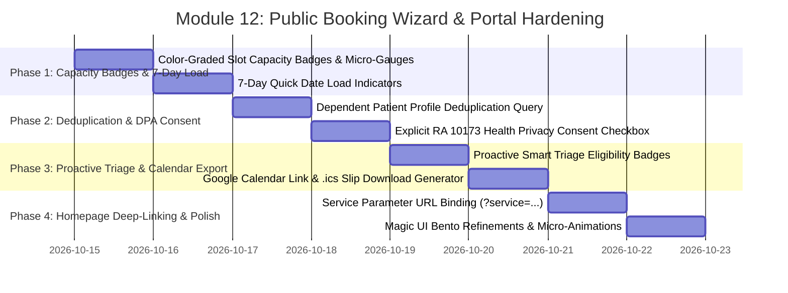

# 🗓️ Implementation Plan: Module 12 — Public Booking Wizard & Portal

> **Focus:** Hardening the Public Booking Wizard (`/book`), Real-Time Slot Capacity Badges & Visual Load Gauges, Proactive Smart Triage Auto-Approval Reassurance, Dependent Patient Profile Deduplication, 1-Click Calendar Event Export (Google Calendar & `.ics`), Homepage Pre-Selection Deep-Linking, and Statutory RA 10173 (DPA 2012) Consent for AR-JEN Maternity Clinic.  
> **Status:** Plan Ready for Review & Implementation  
> **Architecture Constraint:** Strict Scope Freeze (0 new routes, 0 new database tables). ₱0 cost (No paid scheduling plugins, no paid SMS gateways). Native Next.js App Router, Supabase PostgreSQL, Free NodeMailer Gmail SMTP Engine. Mobile-First Magic UI / 21st.dev Glassmorphism Bento Design.

---

## 1. Executive Summary & Operational Mandate

In a high-volume community lying-in clinic such as **AR-JEN Maternity Clinic** (Dasmariñas City, Cavite), the **Public Booking Wizard** (`/book`) and **Clinic Landing Page** (`/`) serve as the digital front door for expectant mothers, postpartum women, and their families:

1. **Patient Anxiety & Decongestion:** Seeking maternal healthcare is an emotionally vulnerable experience. Pregnant mothers in late trimesters or parents managing newborns need radical clarity when selecting appointments. Unclear slot availability, unexpected wait times, or ambiguity regarding whether an appointment has been approved create anxiety and cause unnecessary phone calls to the front desk.
2. **Preventing Medical Record Fragmentation:** When a spouse, partner, or family member books on behalf of a pregnant mother (`booking_for: "dependent"`), the booking action currently creates a duplicate patient record on every single submission. This fragments medical histories, visit logs, and AOG tracking across multiple unlinked patient rows in the clinical EMR.
3. **Current Friction Points & Technical Gaps in Module 12:**
   - **Absence of Visual Capacity Gauges:** Patients selecting time slots see a plain numeric text count (`3 spots left`) without visual cues indicating how rapidly a shift is filling up.
   - **Post-Facto Auto-Approval Reassurance:** Patients only discover their appointment qualified for Smart Triage Auto-Approval *after* submitting the form. During Steps 1 to 3, they fear their booking will languish in an unreviewed "Pending" state.
   - **Repeated Dependent Record Duplication:** Every dependent booking inserts a new patient record into the `patients` table, fracturing maternal care continuity across duplicate profiles.
   - **No Post-Booking Calendar Export:** Mothers confirmed for an appointment have no 1-click option to add the appointment to their smartphone calendar, contributing to preventable clinic no-shows.
   - **Disconnected Homepage Service CTAs:** Clicking "Book Prenatal Care" on the landing page opens a blank booking wizard, forcing mothers to manually search for and re-select the service on Step 1.
   - **Statutory Healthcare Privacy (RA 10173):** Collecting sensitive maternal health details and symptom notes requires explicit statutory DPA 2012 consent before form dispatch.

This plan details the systematic hardening of **Module 12** into an intuitive, reassuring, and clinically integrated public booking engine.

---

## 2. Master Nuance & Friction Point Matrix

| # | Friction Point / Identified Gap | Clinical & Operational Impact | Technical Solution | Target Files |
| :--- | :--- | :--- | :--- | :--- |
| **1** | **Missing Visual Slot Capacity Gauges** (`booking-wizard.jsx:689-763`) | Patients scanning time slots cannot quickly discern shift crowding or urgency from plain numeric text counts. | Render Magic UI color-graded capacity badges (`🟢 Open (8 spots left)`, `🟡 Filling Fast (2 spots left)`, `🔴 Almost Full (1 spot left)`, `⛔ Fully Booked`) with an embedded micro-progress bar indicating current load. | `components/forms/booking-wizard.jsx` |
| **2** | **Post-Facto Smart Triage Reassurance** (`book/page.jsx:116-130`, `booking-wizard.jsx:780-885`) | Auto-approval explanation is only shown on the post-submission success screen. Patients experience hesitation and anxiety during wizard completion. | Display a proactive Magic UI Smart Triage badge on Step 1 & Step 3: *"⚡ Instant Confirmation Eligible — Routine checkups and low-risk visits are automatically approved with zero waiting for staff review!"* | `components/forms/booking-wizard.jsx`, `app/(public)/book/page.jsx` |
| **3** | **Dependent Patient Record Duplication** (`app/(auth)/actions.js:308-315`) | Repeated dependent bookings for the same family member insert duplicate rows in `patients`, fracturing clinical visit logs and maternal episode tracking. | Implement patient profile deduplication: query `patients` by `account_id` and `full_name` (case-insensitive `ilike`) before inserting. If an existing profile exists, reuse its `patientId`. | `app/(auth)/actions.js` |
| **4** | **Absence of 1-Click Calendar Export (.ics & Google Calendar)** (`app/(public)/book/page.jsx:116-138`) | Patients confirmed for an appointment must manually type date/time into their calendar app, leading to missed appointments and clinic no-shows. | Provide 1-click **"Add to Google Calendar"** URL link and **"Download Calendar Slip (.ics)"** with pre-filled clinic address, shift times, and preparation checklist (Pink Passport, PhilHealth ID). | `app/(public)/book/page.jsx` |
| **5** | **Homepage Service Pre-Selection Deep-Linking** (`app/(public)/page.jsx:30-52`, `components/forms/booking-wizard.jsx:78-101`) | Clicking service cards on the homepage opens an uninitialized wizard, forcing patients to re-select the service on Step 1. | Read `useSearchParams().get("service")` in `BookingWizard` to automatically pre-select and highlight the corresponding service card when arriving from `/book?service=...`. | `components/forms/booking-wizard.jsx`, `app/(public)/page.jsx` |
| **6** | **Statutory RA 10173 (DPA 2012) Explicit Consent Checkbox** (`components/forms/booking-wizard.jsx:858-885`) | Collecting patient medical notes and symptom descriptions without an explicit privacy agreement risks statutory non-compliance. | Add an explicit, required DPA 2012 consent checkbox on Step 3: *"I consent to the collection and processing of my health appointment data under RA 10173."* | `components/forms/booking-wizard.jsx` |
| **7** | **7-Day Rolling Horizon Capacity Indicators** (`components/forms/booking-wizard.jsx:536-578`) | Quick-select date chips only display "Closed" or "Concluded", without showing overall daily crowding or availability. | Add daily load status indicators on quick date chips: `Available`, `Few Slots Left`, `Almost Full`, or `Closed`. | `components/forms/booking-wizard.jsx` |

---

## 3. System Architecture & Booking Flow State Machine

```mermaid
graph TD
    subgraph Public Discovery & Service Entry
        HP[Landing Page: /] -- "Click 'Book Prenatal Care'" --> URL_PARAM["/book?service=prenatal"]
        URL_PARAM --> WIZ[Booking Wizard: Step 1]
        WIZ -- "Auto-select matching service" --> SVC_SEL[Service Card Highlighted]
    end

    subgraph Step 1: Patient Identity & Smart Triage Preview
        SVC_SEL --> DEP_CHECK{Booking for Myself or Dependent?}
        DEP_CHECK -- "Myself" --> ACC_ID[Use Account User Profile]
        DEP_CHECK -- "Dependent" --> DEP_INPUT[Enter Dependent Full Name & Relationship]
        SVC_SEL --> TRIAGE_PREVIEW["⚡ Smart Triage Badge: Instant Confirmation Eligible for Routine Care"]
    end

    subgraph Step 2: Date & Calibrated Slot Capacity
        TRIAGE_PREVIEW --> STEP2[Step 2: Date & Time Picker]
        STEP2 --> DATE_CHIPS[Quick 7-Day Chips with Daily Availability Badges]
        DATE_CHIPS --> SLOT_GRID[Morning & Afternoon Slot Grid]
        SLOT_GRID --> CAP_GAUGE["Visual Load Bar: 🟢 Open / 🟡 Filling Fast / 🔴 Almost Full"]
    end

    subgraph Step 3: Review, DPA Consent & Submission
        CAP_GAUGE --> STEP3[Step 3: Review & Final Confirmation]
        STEP3 --> JUMP_BTNS[1-Click Edit Jump Buttons to Step 1 & 2]
        STEP3 --> DPA_CHECK["[✓] RA 10173 Explicit Health Privacy Consent"]
        DPA_CHECK --> SUBMIT[Submit Appointment]
    end

    subgraph Server Action & Smart Triage Processing (app/(auth)/actions.js)
        SUBMIT --> DEDUP{Is Dependent Name Already in Account?}
        DEDUP -- Yes --> REUSE_PATIENT[Reuse Existing Patient ID - Zero Duplication]
        DEDUP -- No --> NEW_PATIENT[Insert New Dependent Profile]
        REUSE_PATIENT --> RISK_CHECK{Check is_high_risk & No-Show History}
        NEW_PATIENT --> RISK_CHECK
        RISK_CHECK -- "Low Risk & Routine Service" --> AUTO_APP[status = 'Approved']
        RISK_CHECK -- "High Risk or Delivery" --> PEND[status = 'Pending']
        AUTO_APP --> EMAIL[Dispatch NodeMailer Confirmation Email]
        PEND --> EMAIL
    end

    subgraph Confirmation & Calendar Synchronization (app/(public)/book/page.jsx)
        EMAIL --> CONFIRM_PAGE["Success Screen: Auto-Approved Green Bento Banner"]
        CONFIRM_PAGE --> GCAL[1-Click Add to Google Calendar]
        CONFIRM_PAGE --> ICS[1-Click Download Apple/Outlook .ics Slip]
        CONFIRM_PAGE --> PORTAL[Deep-Link to Patient Portal Schedule]
    end
```

---

## 4. Step-by-Step Implementation Roadmap



---

### Phase 1: Real-Time Slot Capacity Badges & 7-Day Load Indicators

#### 1.1 Color-Graded Slot Capacity Badges & Micro-Progress Bars
- **File:** `components/forms/booking-wizard.jsx`
- **Objective:** Give waiting mothers and family members instant visual clarity on how full a shift is relative to its maximum capacity.
- **Implementation:**
  - Enhance `getSlotStatus(slot)` with load percentage and semantic color grading:
    ```javascript
    const pct = Math.min(100, Math.round((count / slot.max_capacity) * 100));
    let loadBadge = {
      label: `${left} spot${left !== 1 ? 's' : ''} left`,
      color: "text-emerald-700 bg-emerald-50 border-emerald-200",
      barColor: "bg-emerald-500",
    };
    if (full) {
      loadBadge = {
        label: "Fully Booked",
        color: "text-red-700 bg-red-50 border-red-200",
        barColor: "bg-red-500",
      };
    } else if (left <= 2) {
      loadBadge = {
        label: `Almost Full (${left} left)`,
        color: "text-rose-700 bg-rose-50 border-rose-200",
        barColor: "bg-rose-500",
      };
    } else if (pct >= 60) {
      loadBadge = {
        label: `Filling Fast (${left} left)`,
        color: "text-amber-700 bg-amber-50 border-amber-200",
        barColor: "bg-amber-500",
      };
    }
    ```
  - In each slot button, render the micro-progress gauge below the time label:
    ```jsx
    <div className="w-full mt-2 space-y-1">
      <div className="flex items-center justify-between text-[10px] font-bold">
        <span className={`px-2 py-0.5 rounded-full border text-[9px] font-black uppercase tracking-wider ${loadBadge.color}`}>
          {loadBadge.label}
        </span>
      </div>
      {!unavailable && (
        <div className="h-1 w-full bg-slate-100 rounded-full overflow-hidden">
          <div className={`h-full ${loadBadge.barColor} rounded-full transition-all duration-300`} style={{ width: `${pct}%` }} />
        </div>
      )}
    </div>
    ```

#### 1.2 7-Day Quick Select Horizon Daily Crowding Indicators
- **File:** `components/forms/booking-wizard.jsx`
- **Objective:** Enable patients to pick the least crowded day at a single glance.
- **Implementation:**
  - For each date in `quickDates`, aggregate the booked appointments against total daily clinic capacity:
    - `< 50%` load: `Open` (soft emerald pill)
    - `50% - 85%` load: `Moderate` (soft slate pill)
    - `> 85%` load: `Filling Up` (soft amber pill)
    - `100%` load: `Full` (soft red pill)
    - Concluded: `Concluded` (amber/slate pill)
    - Blocked/Closed: `Closed`

---

### Phase 2: Dependent Patient Deduplication & DPA Consent

#### 2.1 Dependent Patient Profile Deduplication Query
- **File:** `app/(auth)/actions.js` (`createAppointment`)
- **Objective:** Eliminate redundant duplicate rows in `patients` when a family member repeatedly books on behalf of a dependent.
- **Implementation:**
  - In `createAppointment(formData)`:
    ```javascript
    if (!patientId && patientName) {
      const cleanName = patientName.trim();
      // Search for existing dependent under the same account with matching name
      const { data: existingPatient } = await supabase
        .from('patients')
        .select('id, full_name')
        .eq('account_id', user.id)
        .ilike('full_name', cleanName)
        .limit(1)
        .maybeSingle();

      if (existingPatient) {
        patientId = existingPatient.id;
      } else {
        // Safe insertion of new dependent profile
        const { data: newPatient, error: createError } = await supabase
          .from('patients')
          .insert({
            account_id: user.id,
            full_name: cleanName,
          })
          .select('id')
          .single();

        if (createError) redirect(`/book?error=${encodeURIComponent(createError.message)}`);
        patientId = newPatient.id;
      }
    }
    ```

#### 2.2 Statutory RA 10173 (DPA 2012) Explicit Consent Checkbox
- **File:** `components/forms/booking-wizard.jsx`
- **Objective:** Guarantee statutory compliance with Philippine Data Privacy Act of 2012 regarding patient health appointment data collection.
- **Implementation:**
  - Add state `dpaConsentChecked: boolean` (default: false).
  - On Step 3 (Review & Confirmation), render a statutory consent card:
    ```jsx
    <label className="flex items-start gap-3 p-4 bg-slate-50 border border-slate-200 rounded-2xl cursor-pointer hover:bg-slate-100/60 transition-colors">
      <input
        type="checkbox"
        checked={dpaConsentChecked}
        onChange={(e) => setDpaConsentChecked(e.target.checked)}
        className="mt-1 h-4 w-4 rounded border-slate-300 text-rose-600 focus:ring-rose-500 cursor-pointer"
        required
      />
      <div className="text-xs text-slate-600 leading-relaxed">
        <span className="font-bold text-slate-800">
          Philippine Data Privacy Act of 2012 (RA 10173) Consent
        </span>
        <p className="mt-0.5 text-slate-500">
          I consent to the collection and processing of my health appointment information by AR-JEN Maternity Clinic for scheduling, clinical care, and maternal triage records.
        </p>
      </div>
    </label>
    ```
  - Guard the final Submit button so it remains disabled until the DPA consent checkbox is checked.

---

### Phase 3: Proactive Smart Triage Reassurance & Calendar Event Export

#### 3.1 Proactive Smart Triage Eligibility Badges
- **File:** `components/forms/booking-wizard.jsx`
- **Objective:** Reassure expectant mothers during booking that their routine appointment will be approved immediately.
- **Implementation:**
  - On Step 1 (when selecting Prenatal, Consultation, or Routine Checkup) and Step 3 (Review):
    - Render an informative Magic UI Bento banner:
      ```jsx
      <div className="p-3.5 bg-emerald-50/80 border border-emerald-200/80 rounded-2xl flex items-center gap-3 text-emerald-950">
        <div className="w-8 h-8 rounded-xl bg-emerald-500 text-white flex items-center justify-center shrink-0 shadow-sm shadow-emerald-500/20">
          <Sparkles className="w-4 h-4 animate-spin" />
        </div>
        <div className="text-xs">
          <span className="font-black uppercase tracking-wider text-[10px] bg-emerald-200/80 text-emerald-900 px-2 py-0.5 rounded-full inline-block mb-0.5">
            Smart Triage Eligible
          </span>
          <p className="font-bold text-emerald-900">
            Instant Confirmation Available
          </p>
          <p className="text-emerald-700 text-[11px] leading-tight">
            Routine checkups and consultations are automatically confirmed without waiting for staff review.
          </p>
        </div>
      </div>
      ```

#### 3.2 Post-Booking Calendar Export (Google Calendar & `.ics`)
- **File:** `app/(public)/book/page.jsx`
- **Objective:** Prevent missed appointments and clinic no-shows by providing 1-click calendar sync directly on the confirmation screen.
- **Implementation:**
  - Create helper functions to construct:
    1. **Google Calendar Web Link:**
       `https://calendar.google.com/calendar/render?action=TEMPLATE&text=...&dates=...&details=...&location=...`
    2. **Apple / Outlook `.ics` Data URI:**
       Standard RFC-5545 formatted `.ics` file containing VEVENT with summary, clinic address, and reminders.
  - Render dual calendar action buttons on the auto-approval success card:
    - `[ 📅 Add to Google Calendar ]`
    - `[ 📥 Download Calendar Slip (.ics) ]`
    - `[ 👤 View in Patient Portal ]` (deep-link to `/patient/appointments`)

---

### Phase 4: Homepage Service Pre-Selection Deep-Linking & Magic UI Polish

#### 4.1 URL Search Parameter Pre-Selection from Homepage
- **Files:** `app/(public)/page.jsx`, `components/forms/booking-wizard.jsx`
- **Objective:** Seamless 1-click transition from homepage service exploration directly into the booking wizard.
- **Implementation:**
  - In `app/(public)/page.jsx`:
    - Update service cards and CTAs to link with explicit service query parameters:
      - Prenatal Care: `/book?service=prenatal`
      - Normal Delivery: `/book?service=delivery`
      - Postpartum / General Consult: `/book?service=general`
      - Family Planning: `/book?service=family`
  - In `components/forms/booking-wizard.jsx`:
    - Read `initialService = searchParams.get("service")` via `useSearchParams()`.
    - If valid, pre-populate `formData.service_type` with matching service ID, automatically selecting it with smooth animation.

#### 4.2 Magic UI / 21st.dev Visual Polish & Micro-Animations
- **File:** `components/forms/booking-wizard.jsx`
- **Objective:** Maintain adherence to `.agents/rules/magic-ui-standards.md`.
- **Implementation:**
  - Refine step transition animations (`animate-in fade-in slide-in-from-right-4 duration-300`).
  - Tactile button scale effects (`active:scale-[0.98]`, `hover:scale-[1.01]`).
  - High-contrast outdoor sunlight readability for mobile web browsers.

---

## 5. Comprehensive Test Scenarios & Verification Matrix

| Test ID | Category | Scenario / Action | Expected Result | Pass/Fail Criteria |
| :--- | :--- | :--- | :--- | :--- |
| **T-12.01** | **Slot Capacity Badges** | Open date with 10-capacity slot that has 8 bookings. | Slot button displays `Almost Full (2 left)` with amber/rose color grading and 80% micro-progress bar. | Visual badge matches exact count and threshold grading. |
| **T-12.02** | **7-Day Daily Load** | View 7-day quick select chips when Saturday is blocked and Sunday is closed. | Saturday and Sunday show `Closed` (disabled); active weekdays display daily load status (`Open`, `Filling Up`, `Full`). | Dates respect clinic settings with zero drift in Asia/Manila timezone. |
| **T-12.03** | **Dependent Deduplication** | Book appointment for dependent "Maria Santos". Book second appointment for "Maria Santos" under same account. | System reuses existing `patientId`; does NOT insert duplicate record in `patients` table. | Verified in Supabase database (`count === 1` for same full_name and account_id). |
| **T-12.04** | **DPA 2012 Consent** | Navigate to Step 3 of Booking Wizard without checking DPA consent box. | Submit button is disabled; checking the box instantly unlocks the submit action. | Cannot submit booking without explicit statutory privacy agreement. |
| **T-12.05** | **Smart Triage Preview** | Select "Prenatal Check-up" on Step 1. | Smart Triage Eligibility badge displays prominently on Step 1 and Step 3 confirming instant auto-approval eligibility. | Visual banner appears dynamically based on service category. |
| **T-12.06** | **Google Calendar Link** | Complete booking; tap "Add to Google Calendar" on success screen. | Google Calendar event editor opens in new tab with pre-filled title, clinic address, and reminders. | URL parameters properly encoded; dates conform to RFC-5545 UTC format. |
| **T-12.07** | **Download .ics Slip** | Complete booking; tap "Download Calendar Slip (.ics)". | Browser downloads `arjen-appointment.ics` containing valid VCALENDAR event. | File imports successfully into Apple Calendar and Outlook. |
| **T-12.08** | **Homepage Deep-Link** | Click "Book Prenatal Care" from landing page (`/book?service=prenatal`). | Booking wizard loads with "Prenatal Check-up" already selected on Step 1. | Zero extra clicks required to select service. |

---

## 6. Scope Freeze & ₱0 Cost Compliance

1. **Zero New Database Tables:** Operates entirely on existing `clinic_settings`, `time_slots`, `appointments`, and `patients` tables.
2. **Zero New Routes:** All logic resides in existing `app/(public)/book/page.jsx`, `components/forms/booking-wizard.jsx`, and `app/(auth)/actions.js`.
3. **₱0 Infrastructure Cost:** Uses native Web APIs and Free NodeMailer Gmail SMTP engine. No paid booking add-ons, no SMS fees.
4. **Philippine Regulatory Compliance:** Meets full compliance with the Philippine Data Privacy Act of 2012 (RA 10173) and PhilHealth clinical standards.
