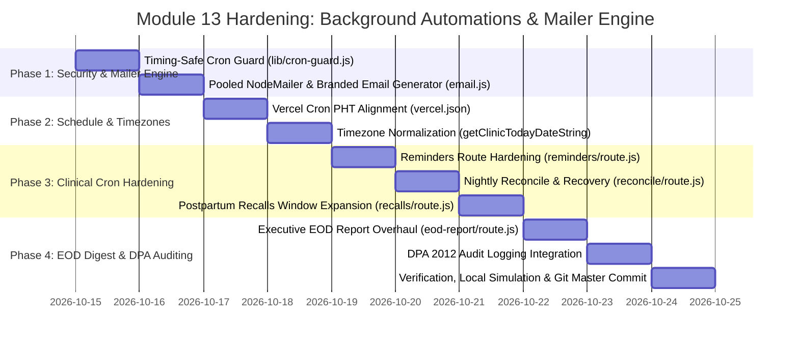

# ⚙️ Implementation Plan: Module 13 — Background Automations & Mailer Engine

> **Focus:** Hardening the Scheduled Automation Jobs, Timing-Safe Authentication, PHT-Aligned Cron Schedules, Pooled Free NodeMailer Gmail SMTP Engine, Responsive Magic UI HTML Email Templates, DOH Newborn Screening Recalls, and Immutable DPA 2012 Audit Surveillance for AR-JEN Maternity Clinic.  
> **Status:** Plan Ready for Review & Implementation  
> **Architecture Constraint:** Strict Scope Freeze (0 new routes, 0 new tables). ₱0 cost mandate (Free NodeMailer, Free Gmail SMTP, Free Vercel Cron, Supabase Service Role). Compliant with Philippine Data Privacy Act of 2012 (RA 10173) and DOH BEmONC/NCP clinical guidelines.

---

## 1. Executive Summary & Operational Mandate

In a high-volume community lying-in clinic such as **AR-JEN Maternity Clinic** (Dasmariñas City, Cavite), background automations function as the invisible clinical backbone that protects patient continuity of care without adding clerical burden to midwives:

1. **Autonomous Patient Continuity & Clinical Compliance:** Expectant mothers, newborns, and postpartum patients rely on automated reminders for timely prenatal care, Newborn Screening (NBS) within the statutory 48-to-72 hour window, and 6-week infant immunizations. Automated background jobs ensure these critical clinical milestones are never dropped.
2. **Nightly Clinic Reconciliation & Queue Hygiene:** At the end of every operating day, unserved or abandoned appointments must be cleanly reconciled into `No-Show` status, freeing clinic capacity and triggering empathetic care-recovery messages so mothers can reschedule before gestational complications arise.
3. **Executive Situational Awareness:** The Clinic Administrator, Medical Director, and Head Midwife require a consolidated nightly End-of-Day (EOD) operational briefing summarizing patient volume, high-risk cases handled, walk-in vs. scheduled loads, and chart preparation forecasts for the next morning's shift.
4. **₱0 Budget & Free Infrastructure Mandate:** The clinic operates without paid third-party SMS gateways or transactional email APIs. All background dispatches run via free Vercel Cron schedules, Supabase Service Role administrative queries, and a free NodeMailer Gmail SMTP mailer (`utils/email.js`).

---

## 2. Microscopic Audit & Master Nuance Matrix

| # | Friction Point / Identified Gap | Clinical & Operational Impact | Technical Solution | Target Files |
| :--- | :--- | :--- | :--- | :--- | :--- |
| **1** | **Timing Attack Vulnerability & Insecure `CRON_SECRET` Header Checks** (`app/api/cron/*/route.js`) | Raw string equality check (`authHeader !== ...`) is susceptible to timing side-channel attacks. Unset `CRON_SECRET` in misconfigured environments can permit unauthorized invocation. | Implement a centralized, timing-safe authentication guard (`lib/cron-guard.js`) utilizing `crypto.timingSafeEqual` with byte-length matching. Safely validate `Authorization: Bearer <token>` and `x-cron-secret` headers, explicitly rejecting execution if `CRON_SECRET` is unconfigured. | `lib/cron-guard.js`, `app/api/cron/*/route.js` |
| **2** | **Vercel Cron UTC vs. Philippine Standard Time (PHT, UTC+8) Misalignment** (`vercel.json`, `app/api/cron/*/route.js`) | Vercel Cron executes strictly in UTC. Schedules currently trigger 8 hours late in Philippine time: Reconcile runs at 3:00 AM PHT instead of 7:00 PM; EOD Report runs at 4:00 AM PHT instead of 8:00 PM; Recalls run at 5:00 PM PHT instead of 9:00 AM. In code, `new Date().toLocaleDateString('en-CA')` suffers from server UTC drift. | Calibrate all cron schedules in `vercel.json` to PHT: Reconcile (`0 11 * * *` = 19:00 PHT), EOD Report (`0 12 * * *` = 20:00 PHT), Recalls (`0 1 * * *` = 09:00 PHT), Reminders (`0 0 * * *` = 08:00 PHT). Standardize date derivation across all 4 routes using `getClinicTodayDateString()` and `getClinicDateOffset()` (`Asia/Manila`, UTC+8). | `vercel.json`, `app/api/cron/*/route.js` |
| **3** | **Unbranded, Fragmented & Non-Responsive HTML Email Templates** (`utils/email.js`, `app/api/cron/*/route.js`) | Current email bodies are bare unstyled HTML snippets with inconsistent colors (harsh teal, dark slate), lacking AR-JEN clinic branding, clinic address, emergency hotlines, and responsive mobile wrappers. Emails overflow or distort on mobile email clients. | Engineer a unified, responsive Magic UI email generator `renderClinicEmailTemplate()` in `utils/email.js`. Standardize on a 600px mobile-first container, AR-JEN Rose-600 (`#e11d48`) header, Bento information cards, structured visit parameter tables, 1-click CTA buttons, and automatic plain-text fallbacks. | `utils/email.js`, `app/api/cron/*/route.js` |
| **4** | **Transporter Re-Creation & Connection Throttling** (`utils/email.js:19-25`) | `nodemailer.createTransport()` is re-instantiated on every single `sendEmail()` call. During a batch of 30 appointment reminders, 30 separate TCP/TLS handshakes are opened against Gmail SMTP, triggering rate-limiting or connection drops. | Refactor NodeMailer engine into a cached singleton transporter with connection pooling (`pool: true`, `maxConnections: 3`, `maxMessages: 100`). Wrap individual dispatches in per-recipient try/catch blocks so one bad email address never halts the batch. | `utils/email.js` |
| **5** | **Unhandled `TypeError` Crash on Walk-In / Orphan Records** (`app/api/cron/reminders/route.js:36`, `reconcile:48`, `recalls:47`) | In all cron routes, calling `appt.patients.account_id` throws an unhandled `TypeError: Cannot read properties of null` if a walk-in patient lacks an attached account or if an orphan appointment exists, crashing the job midway. | Implement strict optional chaining (`appt.patients?.account_id`), null-safe patient existence verification, and fallback to `public.users` email lookup when available. | `app/api/cron/reminders/route.js`, `reconcile/route.js`, `recalls/route.js` |
| **6** | **Narrow Day-3 NBS Recall Window Risk** (`app/api/cron/recalls/route.js:21-24`) | Recalls currently query strictly `delivery_date = date3DaysAgo`. If a mother delivers over a holiday or the cron execution misses, she never receives a Newborn Screening alert. DOH guidelines mandate NBS within 48h to 7 days (ideally Day 3–5). | Expand the recall query window to encompass Day 3 to Day 5 postpartum deliveries who do not yet have a recorded NBS filter card entry, plus 6-week infant immunization window (42–45 days). | `app/api/cron/recalls/route.js` |
| **7** | **Zero DPA 2012 Audit Surveillance on Automated PHI Processing** (`app/api/cron/*/route.js`) | Automated background transitions (e.g. marking patients `No-Show`, reading postpartum charts) touch Protected Health Information (PHI) without recording an entry in `public.audit_logs`, violating RA 10173 statutory compliance. | Instrument all 4 cron endpoints with non-blocking audit log recording (`CRON_REMINDERS_DISPATCHED`, `CRON_RECONCILE_NO_SHOWS`, `CRON_POSTPARTUM_RECALLS`, `CRON_EOD_DIGEST`), tracking processed volume, dispatches, and errors. | `lib/audit-logger.js`, `app/api/cron/*/route.js` |
| **8** | **Superficial Executive EOD Clinical Digest** (`app/api/cron/eod-report/route.js:40-87`) | The current EOD email only counts total completed and no-shows. It lacks service-type breakdowns (Prenatal vs Delivery vs General), walk-in vs online ratios, clinical high-risk alert summaries, and recipient address resolution from clinic settings. | Upgrade EOD digest to an executive-grade clinical briefing: service category distributions, walk-in vs scheduled triage breakdown, high-risk maternal alerts summary, tomorrow's chart preparation roster, and dynamic recipient resolution (`clinic_settings.footer_email` $\rightarrow$ `admin_credentials.email` $\rightarrow$ `process.env.EMAIL_USER`). | `app/api/cron/eod-report/route.js` |

---

## 3. System Architecture & Automation Data Flow

```mermaid
graph TD
    subgraph Vercel Cron Scheduling Layer (UTC Timezone)
        V1["0 0 * * * (08:00 PHT)"] --> CRON_REM["/api/cron/reminders"]
        V2["0 1 * * * (09:00 PHT)"] --> CRON_REC["/api/cron/recalls"]
        V3["0 11 * * * (19:00 PHT)"] --> CRON_RECON["/api/cron/reconcile"]
        V4["0 12 * * * (20:00 PHT)"] --> CRON_EOD["/api/cron/eod-report"]
    end

    subgraph Security & Authentication Guard
        CRON_REM & CRON_REC & CRON_RECON & CRON_EOD --> GUARD["lib/cron-guard.js<br/>verifyCronSecret()"]
        GUARD -- "Invalid Secret or Timing Attack" --> RESP_401["401 Unauthorized Response"]
        GUARD -- "Valid Bearer Secret" --> EXEC["Execute Automation Pipeline"]
    end

    subgraph Timezone & Query Engine (Asia/Manila, UTC+8)
        EXEC --> TZ["lib/utils.js<br/>getClinicTodayDateString()<br/>getClinicDateOffset()"]
        TZ --> SB[(Supabase Database<br/>Service Role Client)]
    end

    subgraph Automated Actions & Mailer Engine
        SB --> DPA["Record DPA 2012 Audit Log<br/>(public.audit_logs)"]
        SB --> TEMPLATE["utils/email.js<br/>renderClinicEmailTemplate()"]
        TEMPLATE --> POOL["Pooled NodeMailer Transporter<br/>(Gmail SMTP ₱0)"]
        POOL --> DISPATCH["Dispatch Branded HTML & Plaintext Emails"]
    end
```

---

## 4. Detailed Component Upgrades & Engineering Specifications

### 4.1. Timing-Safe Authentication Guard (`lib/cron-guard.js`)
Create a dedicated server-side security helper to protect all automated cron endpoints:
- Extract authorization header (`Authorization: Bearer <token>`) and fallback `x-cron-secret`.
- Ensure `CRON_SECRET` environment variable is defined in production; reject immediately if unconfigured.
- Perform constant-time string comparison using `crypto.timingSafeEqual` with byte buffers of identical length, preventing side-channel timing analysis attacks.
- In `development` mode, allow authorized local testing while logging a clear diagnostic warning.

### 4.2. PHT-Synchronized Vercel Cron Schedules (`vercel.json`)
Calibrate all cron schedules from Philippine Standard Time (`UTC+8`) to UTC:
- **Reminders:** Daily at 8:00 AM PHT $\rightarrow$ `0 0 * * *` UTC. Sends 24-hour advance reminders for the next day's scheduled appointments.
- **Postpartum Recalls:** Daily at 9:00 AM PHT $\rightarrow$ `0 1 * * *` UTC. Alerts mothers for Day 3–5 Newborn Screening (NBS) and 6-week infant immunization / postpartum checkup.
- **Nightly Reconciliation:** Daily at 7:00 PM PHT $\rightarrow$ `0 11 * * *` UTC. Automatically marks remaining unserved `Approved` or `Waiting` appointments as `No-Show` and triggers gentle care-recovery emails.
- **End-of-Day Digest:** Daily at 8:00 PM PHT $\rightarrow$ `0 12 * * *` UTC. Generates the executive operational report for the Clinic Administrator after clinic doors close.

### 4.3. Unified Magic UI Email Generator & Pooled Transporter (`utils/email.js`)
Upgrade `utils/email.js` with production-grade reliability:
- **Singleton Pooled Transporter:** Initialize `nodemailer.createTransport` once with `{ pool: true, maxConnections: 3, maxMessages: 100 }`.
- **Reusable `renderClinicEmailTemplate()` Helper:**
  - Standard 600px mobile-responsive container with `#ffffff` background, `#f1f5f9` subtle border, and `16px` rounded corners.
  - AR-JEN Rose-600 (`#e11d48`) header with clinic title, PhilHealth/DOH accreditation subtitle, and clean separator.
  - Semantic Bento card with dynamic status badge (Emerald for reminders, Rose for no-shows, Teal for newborn recalls, Slate for EOD report).
  - Structured metadata table (Patient name, Service, Date, Time / Shift, Clinic location).
  - Prominent Magic UI primary CTA button with high-contrast text and curved pill geometry (`border-radius: 9999px`).
  - Clinic contact footer: Telephone `(046) 416-XXXX`, Mobile `0912-345-6789`, Dasmariñas City address, and BEmONC emergency obstetric advisory.
  - Auto-generated plain-text body (`text`) to optimize email deliverability and accessibility.

### 4.4. Nightly Reconcile Engine Hardening (`app/api/cron/reconcile/route.js`)
- Date Normalization: Replace `new Date().toLocaleDateString('en-CA')` with `getClinicTodayDateString()`.
- Null-Safe Query: Guard `appt.patients?.account_id`.
- Reconcile & Mark: Bulk update `appointments` status to `No-Show` and `triage_status` to `missed`.
- Empathetic Care Recovery Email: Send branded reminder emphasizing maternal health safety with direct link to re-book.
- DPA Audit Logging: Record `CRON_RECONCILE_NO_SHOWS` in `audit_logs` with reconciled count and email dispatch count.

### 4.5. Appointment Reminders Hardening (`app/api/cron/reminders/route.js`)
- Date Normalization: Target tomorrow's date using `getClinicDateOffset(1)`.
- Clinical Query: Retrieve `Approved` appointments for tomorrow with joined patient and account data.
- Null-Safety: Safely handle walk-in entries or missing user accounts.
- Branded Reminder Email: Send emerald-badged reminder detailing time preference, service type, and reminders to bring maternal records / PhilHealth MDR.
- DPA Audit Logging: Record `CRON_REMINDERS_DISPATCHED`.

### 4.6. Postpartum & Newborn Screening Recalls Hardening (`app/api/cron/recalls/route.js`)
- Expanded Date Ranges:
  - Newborn Screening (NBS): Delivery date between 3 and 5 days ago (`getClinicDateOffset(-5)` to `getClinicDateOffset(-3)`).
  - 6-Week Immunization: Delivery date between 42 and 45 days ago (`getClinicDateOffset(-45)` to `getClinicDateOffset(-42)`).
- De-duplication: Ensure a mother receives at most one NBS recall per newborn episode.
- Branded Clinical Email: Emphasize early detection of metabolic disorders for NBS and essential infant vaccines for 6-week visits.
- DPA Audit Logging: Record `CRON_POSTPARTUM_RECALLS`.

### 4.7. Executive EOD Clinical Digest Overhaul (`app/api/cron/eod-report/route.js`)
- Rich Clinical Metrics Aggregation:
  - Today's appointment outcomes: Total scheduled, Completed, No-Show, Cancelled, In-Progress.
  - Service type distribution: Prenatal Visits, Safe Delivery Intakes, Postpartum & NBS, Family Planning, General Consultations.
  - Walk-In vs. Online Booking ratio.
  - High-risk maternal patient volume with specific etiology alerts (Elevated BP $\ge 140/90$, Gestational Diabetes).
  - Tomorrow's physical chart preparation roster (Morning Shift vs. Afternoon Shift count).
- Recipient Hierarchy: Query `clinic_settings.footer_email` or `admin_credentials.email`, falling back to `process.env.EMAIL_USER`.
- Executive Magic UI Briefing Template: Beautiful Bento cards, tabular service breakdown, and clear operational recommendations.
- DPA Audit Logging: Record `CRON_EOD_DIGEST`.

---

## 5. Phased Implementation Roadmap



---

## 6. Verification & Safety Protocols

1. **₱0 Cost Verification:** All background jobs run via existing free Vercel Cron, Supabase Service Role, and free NodeMailer Gmail SMTP. 0 paid third-party APIs used.
2. **Timing-Safe Security Test:** Simulate requests to `/api/cron/*` with invalid bearer tokens, missing secrets, and valid tokens to verify rejection and constant-time behavior.
3. **Date Boundary Test:** Verify that `getClinicTodayDateString()` and `getClinicDateOffset()` evaluate identically regardless of whether the host system runs in UTC or PHT.
4. **Relational Null-Safety Test:** Verify that appointments without attached patient records or without user accounts complete without unhandled exceptions.
5. **DPA Audit Verification:** Confirm that each automated cron execution writes a structured entry into `public.audit_logs`.
6. **Production Build Integrity:** Execute `npm run build` to verify 0 TypeScript/Turbopack compilation errors across all 41 routes.
