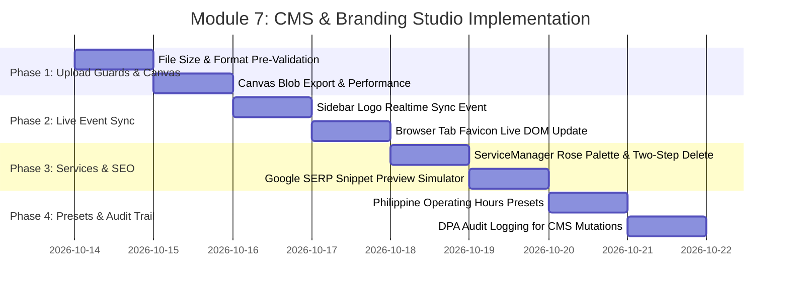

# 🎨 Implementation Plan: Module 7 — Website CMS & Branding Studio

> **Focus:** Hardening the public clinic website CMS, interactive Logo & Favicon Studios, live branding synchronization, and SEO governance for AR-JEN Maternity Clinic.  
> **Status:** Plan Ready for Review & Implementation  
> **Architecture Constraint:** Strict Scope Freeze (0 new routes, 0 new tables). ₱0 cost (No paid APIs). Strict Philippine Standard Time (`Asia/Manila`, UTC+8). Magic UI & 21st.dev design system.

---

## 1. Executive Summary & Objective

**Module 7 (CMS & Branding Studio)** is the public digital face of AR-JEN Maternity Clinic:
1. **Visual Brand Identity (Logo & Favicon Studios):** Dedicated HTML5 Canvas workstations for adjusting, cropping, rotating, scaling, and previewing the clinic's navbar logo and browser favicon across multi-view device simulations.
2. **Hero & Visuals Management:** Dual-image responsive hero layout (left oval mother portrait and right clinical photo) and primary marketing copy.
3. **Public Services Catalog:** Outpatient maternity services (Prenatal, Safe Delivery, Family Planning, General Consults) dynamically synced to public pages and appointment booking wizards.
4. **Clinic Identity & Trust Credentials:** PhilHealth accreditation badges, 24/7 emergency notice banners, about narrative, midwife certifications, and operating hours.
5. **Search Engine Optimization (SEO) & Social Graph:** Meta titles, descriptions, and OpenGraph metadata driving organic discovery for pregnant mothers in Dasmariñas City, Cavite.

This implementation plan resolves client-side file upload vulnerabilities, eliminates stale admin sidebar branding lag with real-time window events, adds an interactive Google SERP preview simulator, hardens the services catalog with two-step safe deletion, refines HTML5 canvas performance, and connects full Data Privacy Act (DPA) audit logging to CMS mutations.

---

## 2. Key Friction Points & Technical Solutions

| # | Friction Point / Bug | Clinical & Technical Impact | Technical Solution |
| :--- | :--- | :--- | :--- |
| **1** | **Missing File Size & Format Guards** (`logo-studio.jsx`, `favicon-studio.jsx`, `cms-manager.jsx`) | Uploading raw camera photos (> 5MB or > 10MB) causes silent upload failures, memory spikes in canvas, or Supabase Storage rejections without helpful error messaging. | Implement client-side pre-validation checking file size (< 3MB for logos/favicons, < 8MB for hero photos) and supported formats (`image/png`, `image/jpeg`, `image/webp`, `image/svg+xml`) with instant Magic UI alert pills before processing. |
| **2** | **Stale Sidebar Brand Logo on Update** (`whatsapp-sidebar.jsx:81-93`) | When an administrator publishes a new logo in Logo Studio, the admin sidebar retains the old logo until a hard browser refresh, confusing clinic staff. | Broadcast a custom window event (`clinic-logo-updated`) upon logo save/remove in [cms-manager.jsx](file:///c:/Users/admin/Desktop/arjen-clinic/components/admin/cms-manager.jsx), and subscribe [whatsapp-sidebar.jsx](file:///c:/Users/admin/Desktop/arjen-clinic/components/ui/whatsapp-sidebar.jsx) to immediately update the sidebar badge in real-time. |
| **3** | **Favicon Update Lacks Live DOM Injection** (`favicon-studio.jsx`) | Updating the favicon saves to `clinic_settings.favicon_url`, but does not update the active browser tab icon until the user navigates away or refreshes. | Dispatch `clinic-favicon-updated` event that dynamically updates the `<link rel="icon">` element in `document.head` in real-time. |
| **4** | **Services Catalog Styling Inconsistency & Direct Deletion** (`service-manager.jsx:40-85`) | `ServiceManager` uses harsh blue utility classes (`bg-blue-600`, `text-blue-500`) that break AR-JEN's rose/slate palette, and clicking the trash button deletes items instantly without confirmation. | Modernize `ServiceManager` to match Magic UI rose/slate standards, add an inline two-step deletion confirmation (`[Delete service?] [Confirm] [Cancel]`), and add service count pills and drag/reorder indicators. |
| **5** | **Blind SEO Meta Authoring** (`cms-manager.jsx:780-840`) | Staff configuring `seo_meta_title` and `seo_meta_description` cannot visualize how the clinic will appear in Google search results or social cards. | Integrate an interactive **Google SERP Snippet Preview Card** displaying real-time character counters, title pixel-width warning (> 60 chars), and description limit indicators (> 160 chars). |
| **6** | **HTML5 Canvas Memory Churn during Drag/Zoom** (`logo-studio.jsx:78-140`) | Re-rendering 512x512 canvas and generating base64 Data URLs on every single mousemove during drag creates memory thrashing and frame drops. | Optimize canvas transforms using `requestAnimationFrame` during active interaction, and convert canvas to binary `Blob` instead of bloated base64 strings when submitting forms. |
| **7** | **Operating Hours Form Free-Text Ambiguity** (`cms-manager.jsx:890-940`) | Clinic schedule fields are arbitrary text inputs susceptible to typos or inconsistent formatting. | Add 1-click Philippine clinical schedule presets (*"Mon-Sat: 8:00 AM - 5:00 PM"*, *"Sunday: 24/7 Delivery Only"*, *"PhilHealth Desk: Mon-Fri 8AM - 3PM"*). |
| **8** | **Missing DPA Audit Trail on CMS Alterations** (`actions.js:2156-2491`) | Public clinic contact numbers, emergency notices, and legal metadata can be altered without creating an audit record in `public.audit_logs`. | Connect `logAuditEvent()` across all CMS mutations in [app/actions.js](file:///c:/Users/admin/Desktop/arjen-clinic/app/actions.js) (`UPDATE_HERO_CONTENT`, `UPDATE_NAVBAR_LOGO`, `UPDATE_FAVICON`, `UPDATE_SERVICES`, `UPDATE_CMS_SETTINGS`). |

---

## 3. Architecture & Data Flow Diagram

```mermaid
graph TD
    subgraph CMS & Branding Studio (/admin/cms)
        A[CMSManager Shell] --> B[Hero & Visuals Tab]
        A --> C[Services Catalog Tab]
        A --> D[Logo & SEO Studio Tab]
        A --> E[About & Trust Tab]
        A --> F[Footer & Operating Hours Tab]

        D --> D1[LogoStudio: 512x512 Canvas]
        D --> D2[FaviconStudio: 256x256 Canvas]
        D --> D3[Google SERP Live Simulator]
        C --> C1[ServiceManager with Safe Two-Step Delete]
    end

    subgraph Client-Side Real-Time Events
        D1 -- "window.dispatchEvent('clinic-logo-updated')" --> G[AppSidebar in whatsapp-sidebar.jsx]
        D2 -- "window.dispatchEvent('clinic-favicon-updated')" --> H[Browser DOM head <link rel=icon>]
    end

    subgraph Server Actions & Data Layer
        B -- "updateHeroImage / updateHeroContent" --> SA[app/actions.js]
        C1 -- "updateServices" --> SA
        D1 -- "updateNavbarLogo" --> SA
        D2 -- "updateFavicon" --> SA
        E -- "updateAboutContent" --> SA
        F -- "updateFooterContent" --> SA
        D3 -- "updateSEOMetadata" --> SA

        SA --> DB[(Supabase clinic_settings)]
        SA --> ST[Supabase Storage: clinic-assets]
        SA --> AL[(Supabase audit_logs)]
    end
```

---

## 4. Step-by-Step Implementation Roadmap



---

### Phase 1: Client-Side Upload Guards & Canvas Performance
- **Target Files:**
  - [components/admin/logo-studio.jsx](file:///c:/Users/admin/Desktop/arjen-clinic/components/admin/logo-studio.jsx)
  - [components/admin/favicon-studio.jsx](file:///c:/Users/admin/Desktop/arjen-clinic/components/admin/favicon-studio.jsx)
  - [components/admin/cms-manager.jsx](file:///c:/Users/admin/Desktop/arjen-clinic/components/admin/cms-manager.jsx)
  - [app/actions.js](file:///c:/Users/admin/Desktop/arjen-clinic/app/actions.js)
- **Key Enhancements:**
  1. **Upload Size Guard:**
     - For Logo & Favicon: Limit to **3 MB**. If file exceeds limit, reject immediately and display alert: *"File exceeds 3 MB limit. Please upload an optimized PNG, SVG, or JPG image."*
     - For Hero Photos: Limit to **8 MB** with instant client feedback.
     - Check file MIME types explicitly against `['image/png', 'image/jpeg', 'image/webp', 'image/svg+xml']`.
  2. **Canvas Memory Optimization:**
     - Replace continuous base64 string allocations during drag/zoom with throttled rendering via `requestAnimationFrame`.
     - In `handleSaveLogo` and `handleSaveFavicon`, export binary `canvas.toBlob()` and append directly to `FormData` rather than generating 1MB+ base64 strings.
  3. **Server-Side File Limit:**
     - Add file size validation guard (< 5MB) in `updateNavbarLogo` and `updateFavicon` in [app/actions.js](file:///c:/Users/admin/Desktop/arjen-clinic/app/actions.js).

---

### Phase 2: Real-Time Branding Synchronization
- **Target Files:**
  - [components/admin/cms-manager.jsx](file:///c:/Users/admin/Desktop/arjen-clinic/components/admin/cms-manager.jsx)
  - [components/admin/logo-studio.jsx](file:///c:/Users/admin/Desktop/arjen-clinic/components/admin/logo-studio.jsx)
  - [components/admin/favicon-studio.jsx](file:///c:/Users/admin/Desktop/arjen-clinic/components/admin/favicon-studio.jsx)
  - [components/ui/whatsapp-sidebar.jsx](file:///c:/Users/admin/Desktop/arjen-clinic/components/ui/whatsapp-sidebar.jsx)
- **Key Enhancements:**
  1. **Sidebar Logo Real-Time Broadcast:**
     - In `handleLogoStudioSave` and `handleLogoStudioRemove` in `cms-manager.jsx`:
       ```javascript
       if (typeof window !== "undefined") {
         window.dispatchEvent(new CustomEvent("clinic-logo-updated", { 
           detail: { logoUrl: result?.publicUrl || null } 
         }));
       }
       ```
     - In `whatsapp-sidebar.jsx`, register an event listener for `clinic-logo-updated` to set `setLogoUrl(e.detail.logoUrl)` instantaneously without waiting for a page reload.
  2. **Browser Tab Live Favicon DOM Update:**
     - In `handleFaviconSave`, `handleFaviconRemove`, and `handleFaviconSyncWithLogo`:
       ```javascript
       if (typeof window !== "undefined") {
         const newIconUrl = result?.publicUrl || "/favicon.ico";
         const existingLink = document.querySelector("link[rel*='icon']");
         if (existingLink) {
           existingLink.href = newIconUrl;
         } else {
           const link = document.createElement("link");
           link.rel = "shortcut icon";
           link.href = newIconUrl;
           document.head.appendChild(link);
         }
       }
       ```

---

### Phase 3: Services Catalog Overhaul & Google SERP Simulator
- **Target Files:**
  - [components/forms/service-manager.jsx](file:///c:/Users/admin/Desktop/arjen-clinic/components/forms/service-manager.jsx)
  - [components/admin/cms-manager.jsx](file:///c:/Users/admin/Desktop/arjen-clinic/components/admin/cms-manager.jsx)
- **Key Enhancements:**
  1. **ServiceManager Visual Modernization:**
     - Convert all blue utility styles (`bg-blue-600`, `focus:ring-blue-500`) to curated Rose / Slate styling (`bg-rose-600`, `focus:ring-rose-500`, `bg-rose-50/40`).
     - Add active service counter badge: `[ 4 Active Services Offered ]`.
     - Implement **Two-Step Safe Deletion**:
       - Clicking the trash button triggers an inline confirmation state: `[Delete this service?] [Confirm] [Cancel]`.
       - Prevents accidental deletion of live services.
     - Add micro-animated save feedback (*"✓ Services Saved"*).
  2. **Interactive Google SERP & Social Preview Card:**
     - In the `Logo & SEO` tab of `CMSManager`, embed a realistic Google Search Simulator card:
       - Displays: `https://arjenclinic.com › ...`
       - Blue clickable title link with real-time text reflection.
       - Character counter with warning pills:
         - Title: `< 60 chars` (Green) vs `> 60 chars` (Amber — *"May be truncated on mobile"*).
         - Description: `< 160 chars` (Green) vs `> 160 chars` (Amber — *"Exceeds optimal SERP snippet limit"*).

---

### Phase 4: Philippine Operating Hours Presets & DPA Audit Trail
- **Target Files:**
  - [components/admin/cms-manager.jsx](file:///c:/Users/admin/Desktop/arjen-clinic/components/admin/cms-manager.jsx)
  - [app/actions.js](file:///c:/Users/admin/Desktop/arjen-clinic/app/actions.js)
- **Key Enhancements:**
  1. **Philippine Maternity Clinic Schedule Presets:**
     - Add 1-click chips for common operating hours:
       - Weekdays: `+ Mon - Fri: 8:00 AM - 5:00 PM`, `+ Mon - Sat: 8:00 AM - 6:00 PM`
       - Saturday: `+ Saturday: 8:00 AM - 12:00 PM`, `+ Saturday: Open for Check-ups`
       - Sunday: `+ Sunday: Closed`, `+ Sunday: On-Call Midwife / Emergency Deliveries Only`
       - Emergency Notice: `+ 24/7 Available for Emergencies & Deliveries`, `+ PhilHealth Accredited Lying-In Facility`
  2. **DPA Audit Log Integration:**
     - Instrument `logAuditEvent()` in [app/actions.js](file:///c:/Users/admin/Desktop/arjen-clinic/app/actions.js) for:
       - `updateNavbarLogo`: action `'UPDATE_NAVBAR_LOGO'`
       - `updateFavicon`: action `'UPDATE_FAVICON'`
       - `updateHeroImage`: action `'UPDATE_HERO_IMAGE'`
       - `updateHeroContent`: action `'UPDATE_HERO_CONTENT'`
       - `updateServices`: action `'UPDATE_CLINIC_SERVICES'`
       - `updateAboutContent`: action `'UPDATE_ABOUT_CONTENT'`
       - `updateFooterContent`: action `'UPDATE_FOOTER_HOURS'`
       - `updateSEOMetadata`: action `'UPDATE_SEO_METADATA'`

---

## 5. Verification & Testing Checklist

- [ ] **Upload File Size Guard:** Test uploading a file > 3MB in Logo Studio and verify human-readable warning displays without page freeze.
- [ ] **Real-Time Sidebar Logo Sync:** Save or remove a logo in Logo Studio and verify that `whatsapp-sidebar.jsx` immediately updates its brand badge without a hard browser reload.
- [ ] **Dynamic Favicon Injection:** Save a favicon and verify that the active browser tab icon reflects the new icon immediately.
- [ ] **Two-Step Safe Delete in Services:** Click trash button on a service in `ServiceManager`, verify confirmation state appears, and confirm cancel restores the card intact.
- [ ] **Google SERP Snippet Preview:** Type in SEO title and description, verify character count gauges update dynamically, and test truncation warnings at > 60 and > 160 characters.
- [ ] **Philippine Schedule Presets:** Click operating hours preset chips and verify inputs auto-populate cleanly.
- [ ] **DPA Audit Trail Recording:** Make an edit in CMS, navigate to `/admin/audit-logs`, and verify that the update event is immutably logged with actor email and timestamp.
- [ ] **Zero Console Warnings:** Pass ESLint and Next.js Turbopack check with 0 compile errors and 0 hydration mismatches.
