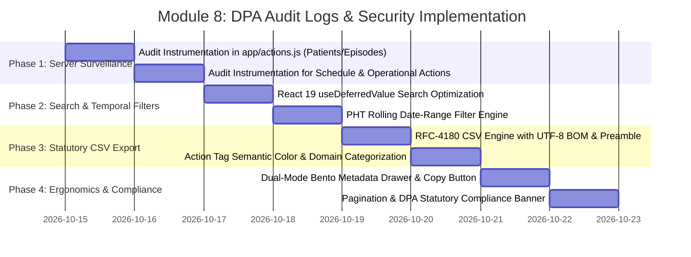

# 🛡️ Implementation Plan: Module 8 — DPA Audit Logs & Security Governance

> **Focus:** Hardening the Medical Audit Trail, Protected Health Information (PHI) access surveillance, statutory reporting extracts under the Philippine Data Privacy Act of 2012 (RA 10173), and Role-Based Access Control (RBAC) governance for AR-JEN Maternity Clinic.  
> **Status:** Plan Ready for Review & Implementation  
> **Architecture Constraint:** Strict Scope Freeze (0 new routes, 0 new tables). ₱0 cost (No paid APIs). Strict Philippine Standard Time (`Asia/Manila`, UTC+8). Magic UI & 21st.dev design system.

---

## 1. Executive Summary & Statutory Objective

In a high-volume lying-in maternity clinic, patient records contain highly sensitive personal information (obstetric history, fetal heart tones, HIV/HBsAg/VDRL lab panels, delivery summaries, and newborn metrics). 

Under the **Philippine Data Privacy Act of 2012 (Republic Act No. 10173)**, **Department of Health (DOH) Administrative Order No. 2016-0035**, and **PhilHealth Circulars**, healthcare institutions are legally mandated to implement robust physical, technical, and organizational security measures. Specifically, Section 12 and 13 of RA 10173 require an **immutable, append-only medical audit trail** recording all access, modifications, and disclosures of Protected Health Information (PHI).

**Module 8 (DPA Audit Logs & Security Governance)** is the administrative surveillance hub where Clinic Administrators and Data Protection Officers (DPOs) monitor and verify compliance:
1. **Immutable Medical Ledger:** High-precision logging of every prenatal visit logged, delivery recorded, lab entry saved, patient registered, record printed, and system setting changed.
2. **Access Control & Surveillance:** Role-based visibility strictly restricted to authorized Clinic Administrators (`users.role = 'admin'`), protecting the surveillance log itself from tampering or unauthorized inspection.
3. **Statutory Regulatory Extraction:** One-click export of an official compliance audit ledger (CSV) formatted for submission to the **National Privacy Commission (NPC)** or **Department of Health (DOH)** during routine licensing or compliance inquiries.
4. **Investigation & Incident Response Ergonomics:** Sub-second search, PHT temporal date filters (Today, Past 7 Days, Past 30 Days), and dual-view structured metadata breakdown for rapid bedside forensic analysis.

---

## 2. Master Nuance & Friction Point Matrix

| # | Friction Point / Gap | Statutory & Clinical Impact | Technical Solution | Target Files |
| :--- | :--- | :--- | :--- | :--- |
| **1** | **Missing Statutory CSV Ledger Export** (`audit-logs-viewer.jsx`) | Under RA 10173 and DOH guidelines, DPOs must be able to export audit records for regulatory inquiries. Currently, records can only be viewed in the browser table. | Build an RFC-4180 compliant **"Download Audit Ledger (CSV)"** generator with UTF-8 BOM (`\uFEFF`), statutory compliance preamble (Clinic facility, DPO email, PHT extraction time, integrity statement), and sanitized tabular data. | `components/admin/audit-logs-viewer.jsx` |
| **2** | **Search Input Performance Degradation** (`audit-logs-viewer.jsx:34-47`) | Filtering hundreds of audit entries with deeply nested JSON metadata strings on every keystroke causes main-thread frame drops and laggy typing. | Decouple search input typing from table filtering using React 19's `useDeferredValue`, ensuring 60fps buttery typing even with large surveillance datasets. | `components/admin/audit-logs-viewer.jsx` |
| **3** | **Absence of PHT Temporal Date Range Filters** (`audit-logs-viewer.jsx:27-52`) | Staff and auditors can only filter by Action Tag or Role. Investigating an incident that occurred during "Yesterday's Shift" or "Past 7 Days" requires manually sifting through hundreds of rows. | Implement a Philippine Standard Time (`Asia/Manila`, UTC+8) date-range selector with quick chips: `All Time`, `Today's Shift`, `Past 7 Days`, `Past 30 Days`, and custom range. | `components/admin/audit-logs-viewer.jsx`, `lib/utils.js` |
| **4** | **Abrupt Raw JSON Detail Drawer** (`audit-logs-viewer.jsx:251-278`) | Expanding an audit event displays a dark `<pre>` code block with raw JSON. Clinical administrators find raw JSON hard to parse during quick bedside inquiries. | Upgrade the expandable drawer with a **Dual-Mode Viewer**: (1) **Structured Bento Breakdown** highlighting clinical keys (Patient ID, Vitals changed, Reason, Service Count) and (2) **Syntax-Highlighted JSON** with a 1-click **"Copy JSON"** button with micro-animated feedback. | `components/admin/audit-logs-viewer.jsx` |
| **5** | **Incomplete Action Tag Category & Color Mapping** (`audit-logs-viewer.jsx:14-25`) | Newly introduced actions from Modules 2, 3, 4, 6, and 7 (e.g. `UPDATE_CLINIC_SERVICES`, `PATIENT_STEPPED_OUT`, `TOGGLE_MCP_OVERRIDE`) fall back to generic gray tags with no clear domain distinction. | Expand `ACTION_COLORS` into 6 curated clinical semantic domains (Clinical/PHI = Emerald, Demographics = Blue, Triage/Queue = Sky, Telehealth = Indigo, System/CMS = Purple, Deletions/Critical = Rose/Amber). | `components/admin/audit-logs-viewer.jsx` |
| **6** | **Surveillance Gaps in Core Server Actions** (`app/actions.js`) | Critical mutations such as `createPatient`, `updatePatient`, `createMaternalEpisode`, `addBlockedDate`, `removeBlockedDate`, `addTimeSlot`, `updateTimeSlot`, `deleteTimeSlot`, and `toggleWeekendBlock` currently bypass `logAuditEvent`. | Instrument all unmonitored server actions in [app/actions.js](file:///c:/Users/admin/Desktop/arjen-clinic/app/actions.js) with structured `logAuditEvent()` calls containing non-PII IDs, diffs, and actor roles. | `app/actions.js` |
| **7** | **DOM Bloat & Table Pagination** (`audit-logs-viewer.jsx`) | Loading and rendering 300+ full table rows simultaneously creates DOM bloat and slow layout calculations. | Add responsive client-side pagination (25 / 50 records per page) with page navigation controls, record count gauges (*"Showing 1-25 of 142 records"*), and fast page jumping. | `components/admin/audit-logs-viewer.jsx` |
| **8** | **Lack of In-App Statutory Retention Notice** (`app/admin/audit-logs/page.jsx`) | Administrators lack quick reference to statutory retention obligations (minimum 5-year clinical record audit retention under DOH A.O. 2016-0035). | Embed a collapsible **Statutory Compliance & DPA Guarantee Card** outlining RA 10173 Section 12/13 compliance, append-only cryptographic immutability, and retention protocols. | `components/admin/audit-logs-viewer.jsx` |

---

## 3. Architecture & Data Flow Diagram

```mermaid
graph TD
    subgraph Clinical & Administrative Actions (Frontend & Staff)
        A1[Doctor/Midwife Logs Visit] --> SA[app/actions.js]
        A2[Nurse Updates Vitals / Triage] --> SA
        A3[Receptionist Registers Walk-In] --> SA
        A4[Staff Updates Patient / Episode] --> SA
        A5[Admin Updates CMS / Schedule / Settings] --> SA
        A6[Staff Prints EMR Summary] --> SA
    end

    subgraph Surveillance Layer (lib/audit-logger.js)
        SA -- "logAuditEvent({ action, entityType, entityId, details })" --> AL[Non-blocking logAuditEvent]
        AL --> SB_DB[(Supabase: public.audit_logs)]
    end

    subgraph Security & RLS Policy
        SB_DB -. "INSERT Policy: Allowed for all staff" .-> SB_DB
        SB_DB -. "SELECT Policy: Strictly users.role = 'admin'" .-> SB_DB
        SB_DB -. "UPDATE / DELETE: NO POLICIES (100% Immutable)" .-> SB_DB
    end

    subgraph Module 8: Audit Logs Viewer (/admin/audit-logs)
        P[app/admin/audit-logs/page.jsx] --> |Fetch initial 300 logs| V[components/admin/audit-logs-viewer.jsx]
        V --> V1[useDeferredValue Search Filter]
        V --> V2[PHT Date-Range Temporal Filter]
        V --> V3[Domain Action Filter Chips]
        V --> V4[Dual-Mode Metadata Drawer: Bento vs Raw JSON]
        V --> V5[1-Click Copy JSON Button]
        V --> V6[RFC-4180 CSV Statutory Export Engine with UTF-8 BOM]
        V --> V7[Client-Side Lean Pagination: 25/50 per page]
    end
```

---

## 4. Step-by-Step Implementation Roadmap



---

### Phase 1: Close Server Actions Audit Surveillance Gaps
- **Target File:** [app/actions.js](file:///c:/Users/admin/Desktop/arjen-clinic/app/actions.js)
- **Actions to Instrument with `logAuditEvent`:**
  1. `createPatient`:
     ```javascript
     await logAuditEvent({
       action: 'CREATE_PATIENT',
       entityType: 'patients',
       entityId: patientRow.id,
       details: { full_name: newPatient.full_name, age: newPatient.age, is_high_risk: newPatient.is_high_risk, blood_type: newPatient.blood_type }
     });
     ```
  2. `updatePatient`:
     ```javascript
     await logAuditEvent({
       action: 'UPDATE_PATIENT',
       entityType: 'patients',
       entityId: id,
       details: { full_name: updateData.full_name, age: updateData.age, is_high_risk: updateData.is_high_risk, blood_type: updateData.blood_type }
     });
     ```
  3. `createMaternalEpisode`:
     ```javascript
     await logAuditEvent({
       action: 'CREATE_MATERNAL_EPISODE',
       entityType: 'maternal_episodes',
       entityId: episodeData?.id || null,
       details: { patient_id, lmp, edc, gravida, para }
     });
     ```
  4. `addBlockedDate` & `removeBlockedDate`:
     - `ADD_BLOCKED_DATE`: `{ blocked_date, reason }`
     - `REMOVE_BLOCKED_DATE`: `{ id }`
  5. `addTimeSlot`, `updateTimeSlot`, `deleteTimeSlot`, `updateTimeSlotCapacity`:
     - `ADD_TIME_SLOT`: `{ label, start_time, end_time, max_capacity }`
     - `UPDATE_TIME_SLOT`: `{ id, label, start_time, end_time, max_capacity }`
     - `DELETE_TIME_SLOT`: `{ id }`
     - `UPDATE_TIME_SLOT_CAPACITY`: `{ id, max_capacity }`
  6. `toggleSaturdayBlock` & `toggleSundayBlock`:
     - `UPDATE_WEEKEND_POLICY`: `{ day: 'Saturday'|'Sunday', is_blocked }`

---

### Phase 2: Search Performance & PHT Temporal Filters
- **Target File:** [components/admin/audit-logs-viewer.jsx](file:///c:/Users/admin/Desktop/arjen-clinic/components/admin/audit-logs-viewer.jsx)
- **Optimizations:**
  1. **`useDeferredValue` Integration:**
     ```javascript
     const [searchTerm, setSearchTerm] = useState('');
     const deferredSearchTerm = useDeferredValue(searchTerm);
     ```
     Input stays instantly responsive, while the log filter runs asynchronously without stutter.
  2. **PHT-Aligned Date Range Filter:**
     - Quick chips: `ALL` (All Time), `TODAY` (Today's Shift in PHT), `7DAYS` (Past 7 Days), `30DAYS` (Past 30 Days).
     - Calculation uses `Asia/Manila` (UTC+8) date comparisons to eliminate UTC boundary slippage.

---

### Phase 3: Statutory CSV Ledger Export Engine
- **Target File:** [components/admin/audit-logs-viewer.jsx](file:///c:/Users/admin/Desktop/arjen-clinic/components/admin/audit-logs-viewer.jsx)
- **Specifications:**
  - **Button:** High-visibility Magic UI export button `[ 📥 Export Statutory Audit Ledger (CSV) ]`.
  - **Character Encoding:** Prepend `\uFEFF` (UTF-8 Byte Order Mark) for instant, seamless opening in Microsoft Excel on Windows without character corruption.
  - **Regulatory Preamble Headers:**
    ```
    "REPUBLIC OF THE PHILIPPINES - DATA PRIVACY ACT OF 2012 (RA 10173) AUDIT LEDGER"
    "Facility Name: AR-JEN Maternity and Lying-In Clinic"
    "Extraction Timestamp (PHT): 2026-10-15 01:25:00 PHT"
    "Extracted By: admin@arjenclinic.com (Clinic Administrator)"
    "Total Filtered Records: 142"
    "Integrity Verification: Immutable Append-Only Ledger Verified"
    ""
    "Log ID","Timestamp (PHT)","Timestamp (UTC)","Staff Email","Staff Role","Action Tag","Entity Type","Entity ID","IP Address","Details Summary"
    ```
  - **RFC-4180 Sanitization:** Escape double quotes (`""`) and wrap all text fields in quotes to prevent CSV injection vulnerabilities.
  - **Filename:** `AR-JEN_DPA_Audit_Ledger_YYYY-MM-DD_HHMM.csv`.

---

### Phase 4: Semantic Domains, Bento Metadata Drawer & Pagination
- **Target File:** [components/admin/audit-logs-viewer.jsx](file:///c:/Users/admin/Desktop/arjen-clinic/components/admin/audit-logs-viewer.jsx)
- **Specifications:**
  1. **Expanded Action Mapping & Domain Categories:**
     - 🩺 **Clinical / PHI:** `LOG_PRENATAL_VISIT`, `RECORD_DELIVERY_EINC`, `RECORD_LAB_PANEL`, `UPDATE_VITALS`, `TOGGLE_MCP_OVERRIDE` (Emerald / Teal)
     - 👥 **Demographics:** `CREATE_PATIENT`, `UPDATE_PATIENT`, `CREATE_MATERNAL_EPISODE`, `REGISTER_WALKIN` (Blue / Indigo)
     - 📋 **Triage & Queue:** `UPDATE_TRIAGE_STATUS`, `PATIENT_STEPPED_OUT`, `PATIENT_RETURNED_TO_QUEUE` (Sky / Cyan)
     - 💬 **Telehealth:** `SEND_CONSULTATION_MESSAGE`, `UPDATE_CONSULTATION_STATUS` (Violet / Indigo)
     - ⚙️ **System & CMS:** `UPDATE_CLINIC_SERVICES`, `UPDATE_NAVBAR_LOGO`, `UPDATE_FAVICON`, `UPDATE_HERO_IMAGE`, `UPDATE_HERO_CONTENT`, `UPDATE_ABOUT_CONTENT`, `UPDATE_FOOTER_CONTENT`, `UPDATE_SEO_METADATA`, `UPDATE_WEEKEND_POLICY`, `ADD_BLOCKED_DATE`, `REMOVE_BLOCKED_DATE`, `ADD_TIME_SLOT`, `UPDATE_TIME_SLOT`, `UPDATE_TIME_SLOT_CAPACITY` (Purple / Slate)
     - ⚠️ **Critical / Deletions / Exports:** `DELETE_VISIT_LOG`, `DELETE_LAB_PANEL`, `DELETE_TIME_SLOT`, `REMOVE_NAVBAR_LOGO`, `REMOVE_FAVICON`, `REMOVE_HERO_IMAGE`, `EXPORT_CLINICAL_SUMMARY`, `LOGIN` (Rose / Amber / Red)
  2. **Dual-Mode Metadata Drawer:**
     - Tab 1: **Structured Bento Breakdown:** Shows key-value badges for common properties (`Patient ID`, `Blood Pressure`, `Gravida/Para`, `Risk Flag`, `Reason`).
     - Tab 2: **Raw JSON Inspector:** Full formatted JSON with a 1-click **"Copy JSON"** button that temporarily displays `Copied! ✓`.
  3. **Client-Side Pagination:**
     - Controls for 25 or 50 records per page.
     - Previous / Next buttons, page number indicators, and record bounds display (*"Showing 1-25 of 142 records"*).
  4. **Collapsible DPA Statutory Compliance Card:**
     - Explains RA 10173 Section 12 & 13 requirements, the immutable append-only database guarantee (no UPDATE/DELETE policies granted in Supabase), and the 5-year clinical record audit retention policy.

---

## 5. Verification & Testing Protocol

1. **Static Analysis & Linting:**
   - Run `npx eslint` across `app/admin/audit-logs/page.jsx`, `components/admin/audit-logs-viewer.jsx`, `lib/audit-logger.js`, and `app/actions.js` to ensure 0 syntax or lint errors.
2. **Access Control (RBAC) Guard Verification:**
   - Verify unauthenticated requests redirect to `/admin/login`.
   - Verify non-admin authenticated users (e.g. Midwife or Nurse role) are blocked by the statutory restriction screen.
   - Verify Admin users view the full ledger.
3. **CSV Export Verification:**
   - Trigger CSV download and verify:
     - Output contains UTF-8 BOM (`\uFEFF`).
     - Standard DPA compliance header preamble is present.
     - Filename matches `AR-JEN_DPA_Audit_Ledger_YYYY-MM-DD_HHMM.csv`.
     - Opens cleanly in Excel and text editors without formatting corruption.
4. **Search & Filter Stress Test:**
   - Test `useDeferredValue` filtering across 300 records with rapid multi-word search queries.
   - Test PHT date range filters (`Today`, `Past 7 Days`, `Past 30 Days`).
   - Test domain action chip filters (`Clinical`, `Demographics`, `Queue`, `System`, `Deletions`).
5. **Mutation Audit Verification:**
   - Execute a patient creation or operational setting update and verify that a corresponding audit log row is created in `public.audit_logs`.
