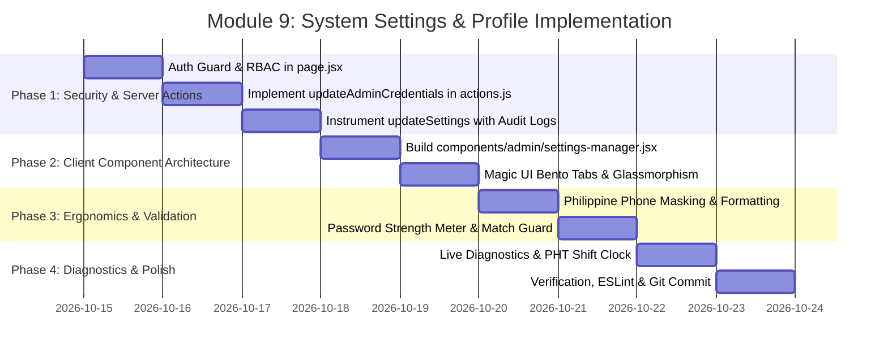

# ⚙️ Implementation Plan: Module 9 — System Settings & Profile

> **Focus:** Hardening the Clinic Operational Profile, Administrator Security Credentials, Philippine Contact Number Masking, Real-time System Diagnostics, and Strict RBAC Governance for AR-JEN Maternity Clinic.  
> **Status:** Plan Ready for Review & Implementation  
> **Architecture Constraint:** Strict Scope Freeze (0 new routes, 0 new tables). ₱0 cost (No paid APIs). Strict Philippine Standard Time (`Asia/Manila`, UTC+8). Magic UI & 21st.dev design system.

---

## 1. Executive Summary & Clinical Governance Context

In a community lying-in clinic such as **AR-JEN Maternity Clinic** (Dasmariñas City, Cavite), system settings and administrative profiles govern the operational identity and technical trust of the entire facility:

1. **Clinic Operational Identity:** Official clinic name, physical address, and hotline numbers are not just UI labels; they are dynamically injected into **DOH Emergency Transfer Slips**, printable clinical summaries, public booking confirmation emails, and SMS-alternative NodeMailer receipts. An erroneous contact number or address directly impairs patient safety during emergency obstetric referrals.
2. **Administrative Security & Access Governance:** Under the **Philippine Data Privacy Act of 2012 (Republic Act No. 10173)**, administrative accounts that possess full clearance to Protected Health Information (PHI) must be secured with robust credential policies (minimum password complexity, real-time match confirmation, and immutable surveillance logging of every credential change).
3. **Current Critical Technical Gaps:**
   - **Zero Route Protection:** [app/admin/settings/page.jsx](file:///c:/Users/admin/Desktop/arjen-clinic/app/admin/settings/page.jsx) currently lacks both an authentication check (`supabase.auth.getUser()`) and an RBAC role guard (`canManageSystemSettings`).
   - **Dead-End Credential Mutation:** `updateAdminCredentials` in [app/actions.js](file:///c:/Users/admin/Desktop/arjen-clinic/app/actions.js) returns a hardcoded error (`'Admin credentials are now managed exclusively via central Auth Provider.'`), meaning password/credential changes are currently broken.
   - **Unvalidated Raw Forms:** Native `<form>` submissions trigger disruptive full-page browser refreshes without client-side phone number masking, password matching feedback, or loading states.
   - **Missing Surveillance Logging:** Clinic profile changes currently bypass `logAuditEvent`, leaving a compliance blind spot in the statutory audit trail.

This plan details the systematic transformation of **Module 9** into a modern, responsive, and secure administrative command center.

---

## 2. Master Nuance & Friction Point Matrix

| # | Friction Point / Identified Gap | Statutory & Operational Impact | Technical Solution | Target Files |
| :--- | :--- | :--- | :--- | :--- |
| **1** | **Missing Authentication & RBAC Route Guard** (`app/admin/settings/page.jsx:10-30`) | Unauthenticated users or non-admin staff (e.g. nurses/midwives) could potentially view or tamper with clinic settings if accessed directly. | Implement server-side session authentication check (`redirect('/admin/login')`) and role verification (`canManageSystemSettings(role)`), presenting an access-restricted banner if unauthorized. | `app/admin/settings/page.jsx` |
| **2** | **Broken / Mocked `updateAdminCredentials`** (`app/actions.js:2070-2073`) | Submitting the credential form fails silently with an unhandled server error string, preventing administrators from updating passwords or emails. | Implement real Supabase Auth password and email mutation via `supabaseServer.auth.updateUser()`, synchronize `public.users`, and record an immutable audit event (`UPDATE_ADMIN_CREDENTIALS`). | `app/actions.js` |
| **3** | **No Client-Side Password Confirmation & Strength Pre-Validation** (`app/admin/settings/page.jsx:153-176`) | Administrators can submit mismatched passwords or weak credentials (<8 chars), causing failed server round-trips with zero inline visual guidance. | Build real-time match detection, visual strength meter (Weak / Moderate / Strong), minimum 8-character enforcement, and password show/hide toggles. | `components/admin/settings-manager.jsx` |
| **4** | **Unvalidated Arbitrary Contact Number Input** (`app/admin/settings/page.jsx:72-80`) | Staff can type malformed contact numbers (e.g., `1234`), corrupting contact headers on DOH referral forms and booking notifications. | Implement real-time Philippine contact format masking (`09XX-XXX-XXXX` or landline `(046) XXX-XXXX`) with instant validity badges. | `components/admin/settings-manager.jsx` |
| **5** | **Full-Page Server Reloads & No Optimistic State** (`app/admin/settings/page.jsx:49-88`) | Clicking "Update Profile" causes a disruptive full-page refresh with no loading spinner, transition state, or confirmation toast. | Extract settings interface into a Magic UI client component (`SettingsManager`) powered by `useTransition` and micro-animated `✓ Saved` feedback badges. | `components/admin/settings-manager.jsx`, `app/admin/settings/page.jsx` |
| **6** | **Missing Audit Surveillance on Clinic Profile Updates** (`app/actions.js:1494-1511`) | Profile modifications (clinic name, address, contact) are not logged to `public.audit_logs`, violating RA 10173 accountability mandates. | Instrument `updateSettings` with `logAuditEvent` capturing `UPDATE_CLINIC_PROFILE` with changed field diffs, actor email, and timestamp. | `app/actions.js` |
| **7** | **Underutilized Clinic Settings Fields** (`clinic_settings` table) | High-utility fields already in the database—such as `emergency_notice` (triage advisory) and `footer_email`—are missing from the settings UI. | Expand form inputs to expose `emergency_notice` and `footer_email`, giving administrators control over clinical advisories without editing CMS code. | `components/admin/settings-manager.jsx`, `app/actions.js` |
| **8** | **Lack of System Health & Compliance Diagnostics** | Clinic administrators have no single dashboard view to verify database connectivity, mailer health, or Philippine Standard Time clock synchronization. | Embed a **Live System Diagnostics Bento Card** showing Supabase DB status, NodeMailer Gmail SMTP status, PHT live shift clock, and DOH/PhilHealth compliance indicators. | `components/admin/settings-manager.jsx` |

---

## 3. System Architecture & Data Flow

```mermaid
graph TD
    subgraph Client Browser (Admin Portal)
        A[Administrator Navigates to /admin/settings] --> B[app/admin/settings/page.jsx]
        B --> C{Authenticated & Admin Role?}
        C -- No --> D[Redirect to /admin/login OR Show Access Denied]
        C -- Yes --> E[components/admin/settings-manager.jsx]

        E --> T1[Tab 1: Clinic Profile & Emergency Notice]
        E --> T2[Tab 2: Security & Admin Credentials]
        E --> T3[Tab 3: System Diagnostics & Compliance]
    end

    subgraph Client-Side Validation Engine
        T1 --> V1[Philippine Contact Number Masking 09XX-XXX-XXXX]
        T2 --> V2[Password Strength Meter & Live Match Detection]
    end

    subgraph Server Mutations (app/actions.js)
        T1 -- "updateSettings(formData) via useTransition" --> S1[app/actions.js: updateSettings]
        T2 -- "updateAdminCredentials(formData) via useTransition" --> S2[app/actions.js: updateAdminCredentials]
    end

    subgraph Supabase & Infrastructure Layer
        S1 --> DB1[(clinic_settings table)]
        S1 --> AL1[logAuditEvent: UPDATE_CLINIC_PROFILE]
        
        S2 --> AUTH[supabase.auth.updateUser: password, email]
        S2 --> DB2[(users table: email, full_name)]
        S2 --> AL2[logAuditEvent: UPDATE_ADMIN_CREDENTIALS]
    end

    subgraph Feedback & Cache Revalidation
        S1 --> R1[revalidatePath: /admin/settings, /public]
        S2 --> R2[revalidatePath: /admin/settings]
        R1 --> FB[Micro-animated '✓ Saved' Badge & Toast Notification]
        R2 --> FB
    end
```

---

## 4. Step-by-Step Implementation Roadmap



---

### Phase 1: Route Protection, RBAC & Server Actions Hardening

#### 1.1. Server-Side Authentication & RBAC Guard in `app/admin/settings/page.jsx`
- Replace open server fetch with strict session authentication:
  ```javascript
  const supabase = await createClient();
  const { data: { user }, error: authError } = await supabase.auth.getUser();
  if (authError || !user) {
    redirect('/admin/login');
  }

  const { data: userData } = await supabase
    .from('users')
    .select('role, full_name, email')
    .eq('id', user.id)
    .single();

  if (!canManageSystemSettings(userData?.role)) {
    return <AccessRestrictedBanner />;
  }
  ```
- Fetch authenticated user details and initial `clinic_settings` data to pass into the client manager component.

#### 1.2. Fully Functional `updateAdminCredentials` in `app/actions.js`
- Replace placeholder rejection with production Supabase Auth mutation:
  - Verify admin session via `verifyAdmin()`.
  - Validate password length ($\ge 8$ chars) and match confirmation.
  - Update user password via `supabaseServer.auth.updateUser({ password })`.
  - If email is updated, update via `supabaseServer.auth.updateUser({ email })` and mirror to `public.users`.
  - Record immutable audit event `UPDATE_ADMIN_CREDENTIALS` via `logAuditEvent`.
  - Return `{ success: true }` or `{ success: false, error: message }`.

#### 1.3. Audit Logging & Extended Fields in `updateSettings` in `app/actions.js`
- Accept and upsert:
  - `clinic_name`, `clinic_address`, `clinic_contact`
  - `footer_email`, `emergency_notice`
- Call `logAuditEvent`:
  ```javascript
  await logAuditEvent({
    action: 'UPDATE_CLINIC_PROFILE',
    entityType: 'clinic_settings',
    entityId: '1',
    details: { clinic_name, clinic_address, clinic_contact, footer_email }
  });
  ```
- Revalidate paths `/admin/settings`, `/admin`, `/(public)`, and `/book`.

---

### Phase 2: Dedicated Client Component (`components/admin/settings-manager.jsx`)

#### 2.1. Magic UI & 21st.dev Component Architecture
- Construct `SettingsManager` with 3 segmented navigation tabs:
  1. **Clinic Profile & Hotline** (Identity, Address, Contact, Emergency Notice)
  2. **Security & Credentials** (Admin Email, Password Change, Session Info)
  3. **System Diagnostics** (Database health, Mailer status, Live PHT Clock, Statutory Badges)
- Use standard glassmorphic styling: `bg-white/80 backdrop-blur-md border border-gray-200/80 rounded-3xl p-6 md:p-8 shadow-sm`.
- Wrap server actions inside `useTransition` to provide instant `isPending` state without page reloads.

---

### Phase 3: Input Masking, Password Strength & Ergonomics

#### 3.1. Philippine Phone Number Masking & Sanitizer
- Auto-format inputs as the user types:
  - Mobile: `0917-123-4567` (11 digits, starts with `09`)
  - Landline: `(046) 416-XXXX` (Dasmariñas / Cavite area code `046`)
- Display visual validation badge:
  - Emerald badge: `✓ Valid PH Mobile (09XX-XXX-XXXX)`
  - Amber badge: `⚠️ Incomplete Contact Number`

#### 3.2. Password Strength Meter & Real-Time Confirmation Guard
- Calculate password complexity on the fly:
  - Score 1 (Weak): $<8$ characters
  - Score 2 (Moderate): $\ge 8$ characters with numbers
  - Score 3 (Strong): $\ge 10$ characters with mixed-case and special symbols
- Progress bar indicator with color shifts (Red $\rightarrow$ Amber $\rightarrow$ Emerald).
- Real-time comparison between `new_password` and `confirm_password`:
  - Matching: Emerald checkmark pill `✓ Passwords Match`
  - Mismatch: Rose warning pill `✕ Passwords Do Not Match`
  - Disable submit button while passwords mismatch or strength is insufficient.
- Toggleable Show/Hide password eye icons (`Eye` / `EyeOff`) for both password fields.

---

### Phase 4: System Diagnostics & Health Bento Grid

#### 4.1. Live Diagnostic Cards
- **Database Engine:** Supabase PostgreSQL — `Operational / Active` (with green pulse).
- **Notification Engine:** Free NodeMailer Gmail SMTP (`utils/email.js`) — `Configured / Active`.
- **System Shift Time:** Real-time ticking Philippine Standard Time clock (`Asia/Manila`, UTC+8).
- **Statutory Compliance Badges:**
  - `RA 10173 DPA Compliant` (Data Privacy Act of 2012)
  - `DOH BEmONC Standard` (Basic Emergency Obstetric and Newborn Care)
  - `PhilHealth MCP Ready` (Maternity Care Package Clinical Compliance)

---

## 5. Verification & Acceptance Criteria

1. **RBAC Guard:** Unauthenticated visits to `/admin/settings` redirect to `/admin/login`. Non-admin accounts receive the access-restricted alert.
2. **Credential Mutation:** Changing admin password successfully updates Supabase Auth, allows immediate login with the new password, and records `UPDATE_ADMIN_CREDENTIALS` in the audit logs.
3. **Password Validation:** Mismatched passwords immediately block submission and show an inline rose alert.
4. **Phone Masking:** Typing `09171234567` automatically formats as `0917-123-4567`.
5. **Profile Persistence:** Updating clinic profile saves without page refresh, displays `✓ Saved`, and updates the audit trail.
6. **Code Quality:** Zero ESLint errors or warnings, clean React 19 execution, zero hydration mismatches.
7. **Scope & Budget Freeze:** 0 new tables, 0 paid APIs, 100% adherence to existing design tokens.
